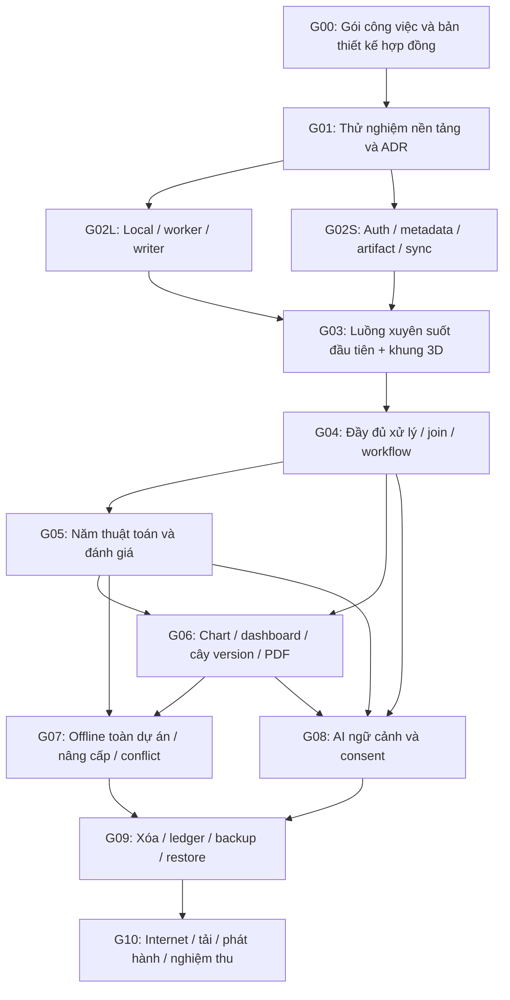

# Kế hoạch triển khai theo giai đoạn

Ngày lập: 02/11/2026. Trạng thái: kế hoạch, chưa viết code, chưa chạy thử nghiệm, chưa chọn provider hoặc chứng minh hiệu năng. Không đặt lịch cam kết khi chưa có kết quả thử nghiệm và nguồn lực thực hiện.

## 1. Căn cứ và cách dùng

Ba tài liệu điều phối là [README v2](../prompt/v2/README.md), [hợp đồng C01–C22](../prompt/v2/hop_dong_tich_hop.md), [quyết định và nghiệm thu](../prompt/v2/quyet_dinh_va_nghiem_thu.md). Tám thiết kế trong v2 là đặc tả chuyên phần; mã CN/NÚT/OFF/DB/BE/FE/3D/WS được định nghĩa tại tài liệu quyết định §1.

Kế hoạch này chuyển bộ v2 thành các phần việc và điều kiện bàn giao, không lặp lại việc rà soát mâu thuẫn đã hoàn thành. P01–P16 giữ nguyên; T là cách thực hiện đề xuất; V01–V05 cần bằng chứng; Q chỉ phát sinh khi thật sự thay đổi phạm vi/chi phí/quyền dữ liệu. Chưa có quyền triển khai chỉ vì đọc kế hoạch này.

Mỗi giai đoạn phải có: danh mục công việc, sản phẩm bàn giao, hợp đồng liên quan, tiêu chí kết thúc và trạng thái V. Không đánh dấu hoàn thành chỉ vì có giao diện hoặc endpoint. Có thể chuẩn bị phần độc lập khi một V bị chặn; phần phụ thuộc không được bật bằng adapter giả hoặc kết quả mẫu. Tất cả phương pháp và năm thuật toán P vẫn thuộc phạm vi cuối cùng, dù được làm ở các giai đoạn khác nhau.

## 2. Thứ tự phụ thuộc

G02L và G02S có thể tiến hành độc lập sau khi có cùng schema/fixtures; đây là phụ thuộc công việc, không yêu cầu chia agent. G06 có thể làm chart/bố cục trước G05, nhưng phần PCA/model/report chỉ kết thúc sau G05. G08 chuẩn bị adapter giả/consent sau G03; hoàn thiện gợi ý kết quả cần G05–G06. G09 có thể thử ledger sớm ở G01 và xây trước G08; nghiệm thu tổng thể cần đủ các loại tài nguyên để kiểm tra phụ thuộc.

Session fence, tombstone, reference graph, serverGeneration, migration journal và release compatibility phải có trong thiết kế G00 và nền G02. G09 là mốc bật xóa/restore hoàn chỉnh, không phải lúc mới nghĩ đến các cơ chế này. Nginx dev/test và nghiên cứu hosting bắt đầu G01; G10 mới nghiệm thu điểm truy cập Internet.

Đường phụ thuộc dài dự kiến là G00 → G01 → G02L/G02S → G03 → G04 → G05/G06 → G07 → G09 → G10. Nhánh AI G08 cũng phải xong trước nghiệm thu toàn bộ; không coi lỗi provider là lý do tự bỏ P10.

## 3. Các giai đoạn và cổng nghiệm thu

### G00 — Chuyển đặc tả thành gói công việc có thể kiểm tra

**Phụ thuộc:** bộ v2 hiện hành. Không mở lại các quyết định P.

**Bàn giao:** bảng nhiệm vụ có ID, P/C/ca nghiệm thu liên quan, module phụ trách, dependency và trạng thái; danh mục JSON Schema/OpenAPI phải tạo; bảng field/index/ref; đặc tả fixture và lỗi. Chuẩn bị danh sách toàn bộ operation trong NÚT, phân loại view/version/artifact/config/control và learnsParameters. Chỉ lập thiết kế/schema danh mục ở giai đoạn kế hoạch hiện tại, không sinh schema thực thi trong nhiệm vụ này.

**Kiểm tra:** C01–C22, CN §18–20 và quyết định §1/§3/§5. Mỗi P01–P16 có giai đoạn thực hiện và tiêu chí; mỗi operation có đầu vào/đầu ra/validator/offline capability; loại bỏ công việc không có phụ thuộc hoặc đầu ra rõ. Gói thiết kế phải có fences/tombstone/migration/ledger ngay từ đầu.

**V trước bước kế tiếp:** lập các câu hỏi kiểm chứng V01–V05 cho G01, chưa cần chọn provider. Kết thúc khi backlog và điều kiện bàn giao đủ cụ thể, không phải kết luận stack đã hoạt động.

### G01 — Thử nghiệm nền tảng và chọn giải pháp T bằng bằng chứng

**Phụ thuộc:** G00. Các thử nghiệm X01–X09 ở §4 được đề xuất thực hiện trong nhiệm vụ triển khai sau.

**Bàn giao:** ma trận ứng viên tối đa hai lựa chọn cho mỗi nhóm quan trọng; báo cáo kết quả thử; ADR chọn/bác bỏ; danh sách package/version/license; capability matrix và limits profile ban đầu; phương án dev/test có MongoDB transaction, Nginx và storage bền. Chưa cần tài nguyên Internet thật để bắt đầu phần local.

**Kiểm tra:** C02–C07, C12–C13, C19–C21; BE §2.2/14, WS §5, 3D §11.4. Các thử nghiệm cần chứng minh khả năng tối thiểu cho từng nhánh: byte/hash roundtrip, writer độc quyền, session fence/receipt, browser/offline engine, 3D/PNG/PDF và lưu trữ bền. Không chọn vì chỉ chạy được ví dụ online.

**V:** V01 phải có kết quả nền đủ cho G02L và các engine bắt buộc; V02 phải có môi trường dev/test đáp ứng transaction/artifact/Nginx cho G02S, còn hosting Internet có thể tiếp tục đánh giá; V04 có số đo ban đầu; V05 có thiết kế/khả năng thử ledger. V03 được điều tra sớm nhưng chưa cản G02. Engine chưa đạt thì tiếp tục chọn giải pháp đáp ứng P, không bỏ thuật toán. Chưa đủ bằng chứng cho một adapter thì adapter đó chưa được bật.

### G02L — Nền local, worker, writer và phục hồi

**Phụ thuộc:** G00; kết quả X01/X02 và phần engine/serializer X04 của G01.

**Bàn giao khi triển khai:** packages hợp đồng/registry/data-format dùng chung; local store adapter, staging/commit marker/outbox, worker protocol, resource estimator, account generation, Web Lock/writer fence; recovery sau refresh, hủy và lỗi quota. Fixtures bảng/CSR có row/column lineage, clock và crash injection phục vụ tích hợp. Trạng thái UI lưu/sync tách riêng ngay từ đầu.

**Kiểm tra:** C01–C06, C09, C20; I09–I15, I17–I18; OFF §13, DB04/08–09/15/24, FE06/19/23/26. Fault injection trước/sau commit phải cho đúng version/history/outbox; RESULT chưa là success; hai tab không commit đồng thời; chuyển nguồn không nhận output sai. Không bắt buộc server mới công nhận lưu local.

**V:** V01 browser storage/Web Locks/worker và V04 RAM/cancel/parse phải đạt trên Chrome/Edge đại diện. Module chưa có cache/offline asset đầy đủ chưa được quảng bá offline-ready.

### G02S — Nền xác thực, metadata, artifact và sync server

**Phụ thuộc:** G00; X03 và phương án hạ tầng dev/test X07 của G01. Dùng cùng contracts/fixtures với G02L.

**Bàn giao khi triển khai:** auth/OTP/profile/reset, session fence, owner validation; metadata/version/branch/lineage, artifact upload/chunk/verify/ready, commit service/receipt/partial ACK, revision/conflict và các kiểm tra tombstone; API envelope/capabilities/health; adapter mail/storage giả cho kiểm thử. Có migration/version compatibility và skeleton reference/deletion job/generation; chưa mở thao tác xóa thật trước G09.

**Kiểm tra:** C01–C03, C07–C11, C17–C18, C20–C21; I01–I03, I19–I22, I35; BE01–08/11–15/26, DB12–14/25–26. Chứng minh 99→100 không thành 101; session cũ không commit sau thu hồi; retry cùng mutation không trùng; chưa đủ artifact không có version ready; không endpoint CRUD vượt commit service.

**V:** V02 transaction deployment, private persistent storage, mail sender; V04 hashing/concurrency/backpressure. Mail giả chỉ dùng dev/test; đăng ký công khai không được bật trước khi email thật đạt X08. Chưa chọn hosting không ngăn xây local/dev API nhưng ngăn nghiệm thu Internet.

### G03 — Luồng xuyên suốt đầu tiên và khung làm việc 3D thật

**Phụ thuộc:** G02L + G02S; kết quả render tối thiểu X05.

**Bàn giao khi triển khai:** UI auth/dự án, chọn nguồn, bản đồ 3D thật và đường truy cập 2D; form đầy đủ tham số, preview, trung tâm task/sync; luồng online import CSV/JSON → V0 → làm sạch HTML/điền thiếu → V1/V2 → local commit → upload/ACK → mở lại. Import intent có retry/renew, mất mạng sau START giữ đúng trạng thái. Có undo tạo nhánh khi làm tiếp và nguồn hiện hành rõ ràng.

**Kiểm tra:** C01–C11, C15, C18; I04–I07/I11–I15/I17–I22; AC01–03/05/08/20–24/28–30, FE03–09/19–26, 3D-01–05/11/16–18. Tiêu chí mốc: dùng dữ liệu thực, refresh đúng bản commit, mất ACK không trùng, tab khác không vượt sync gate và kết quả thuộc đúng nguồn.

**V:** V01 UI/3D/render/worker tích hợp, V02 dev artifact/auth, V04 bộ nhớ/đáp ứng. Đây là mốc chứng minh tích hợp, không phải bản đầu được phép bỏ các phương pháp còn lại hoặc coi placeholder là chức năng đã hỗ trợ.

### G04 — Đầy đủ làm sạch, tiền xử lý, nối/ghép và workflow

**Phụ thuộc:** G03; X01/X04 cho sparse/feature expansion và validator.

**Bàn giao khi triển khai:** toàn bộ thao tác CN §7–8/NÚT §4.3–4.7, thống kê/chất lượng chỉ đọc; concat/inner-left join online tạo dataset mới với lineage; workflow ghi từ thao tác hoặc cấu hình trước, mapping cột, kiểm tra từng bước, commit từng bước, cancel và resume bằng run mới. Mỗi phương pháp có schema/preview/resource estimate/executor và thông báo lỗi; không có phương pháp chỉ hiện tên mà không chạy được.

**Kiểm tra:** C03–C06, C08–C12, C20; I08–I16/I18; AC04–11/23/29, DB03–07, FE07–11. Lập checklist từng operation: HTML, chuỗi, kiểu/đơn vị/cột/dòng/trùng/outlier; missing cơ bản/theo nhóm/ffill/bfill/nội suy/cờ; Label/Ordinal/One-Hot; Min-Max/Standard/Robust/log/binning; công thức/ngày/TF-IDF/cột hằng/chọn roles. Chạy lại workflow trên cột đổi tên có mapping; bước 3 lỗi không chạy bước 4, giữ 1–2.

**V:** V01 parser/tokenizer/sparse và V04 post-parse/post-join/feature limits/cancel. Không vượt ngưỡng bằng cách giảm mẫu/đặc trưng hoặc đổi join ngầm; không tự coi 50 cột đầu vào là trần ma trận sau biến đổi.

### G05 — Năm thuật toán, đánh giá và mô hình

**Phụ thuộc:** G04; X04 đạt cho từng engine adapter.

**Bàn giao khi triển khai:** Linear Regression, Logistic Regression, KNN phân lớp, K-Means, PCA trong worker; config/validation/resources/cancel đúng từng thuật toán; supervised split row IDs, fitted pipeline, metrics có lý do undefined; model/serializer export, kiểm thử tái nạp kỹ thuật; so sánh run có nguồn/split/features/engine. PCA giữ artifact riêng, áp thành version qua thao tác riêng có xác nhận.

**Kiểm tra:** C03–C05, C12, C20; I10/I25–I27, AC12–13/19, DB18, FE12, NÚT §4.8–4.9. Có fixture đáp án kiểm tra độc lập cho metric/fit; PCA/K-Means không đòi nhãn/split supervised. Kiểm fit train-only, unknown categories, target hằng, lớp không được dự đoán, sparse unsupported; lưu lại split/mapping để tái hiện. Không thêm prediction trên dữ liệu mới.

**V:** V01 binary/multiclass/sparse/cancel/serializer theo từng adapter; V04 bộ nhớ/chi phí KNN, PCA, Silhouette và sampling được duyệt. Năm thuật toán đều là bàn giao bắt buộc; capability chỉ bật cho đầu vào/tham số đã xác minh, không biến phần chưa đạt thành đã loại khỏi phạm vi.

### G06 — Cây phiên bản, chart/dashboard và xuất/PDF hoàn chỉnh

**Phụ thuộc:** G04 + G05; X05/X06 đạt. Cấu trúc màn hình có thể chuẩn bị từ G03.

**Bàn giao khi triển khai:** cây version nhiều nguồn ở màn hình riêng, metadata phân trang/so sánh/tiếp tục; bản đồ 3D theo dõi đúng run/step; đủ Histogram/Box/Bar/Line/Scatter/Correlation/Pie–Donut/Scatter3D; dashboard nhiều trang layout 1/2/3; đổi nguồn có validator; CSV/JSON/model/chart export và PDF chọn phần/font Việt local. Có dark/light, bàn phím, giảm chuyển động, camera lưu theo C14, fallback 2D/GPU recovery; điện thoại xem đúng phạm vi.

**Kiểm tra:** C03, C05, C12, C14–C15, C20; I14/I27–I28/I34; AC17–18, DB17/20, FE16–18/27–31 và ma trận 3D. Chart pin nguồn; bỏ khỏi dashboard không xóa nguồn; hard refs chặn xóa chart. PCA scatter có phương sai/row mapping/sample; camera không tạo version; PNG/PDF không rỗng, nguồn/metric tiếng Việt đúng.

**V:** V01 chart/3D/PNG/model/PDF/font; V04 GPU/RAM/layout và đồ thị lớn. Chưa kiểm chứng export nào thì export đó chưa bật; không giả định mọi engine đều xuất vector. Khung 3D không được thay bằng thẻ CSS nghiêng.

### G07 — Offline toàn dự án, conflict và nâng cấp an toàn

**Phụ thuộc:** G03–G06; X02/X06/X07 về SW/cache/byte/persistence. Offline xử lý local đã có từ G02L; giai đoạn này kiểm chứng toàn bộ dự án và vòng đời release.

**Bàn giao khi triển khai:** project/app manifests cùng snapshot/build; prepare/resume/verify đầy đủ, status currentContext/fullProject; lazy modules vào manifest, fonts/workers/render/export offline; outbox/reconciliation/blockedDeleted; UI nhánh/config copy, reauth và logout đầy đủ; migration journal, current/previous release và Service Worker activation có kiểm soát.

**Kiểm tra:** C06–C07, C09–C11, C13, C18, C21; I04/I15/I17–I24/I27/I32; AC19–24/28–29, OFF §13, DB09–16/23–26, FE20–26/28, WS16–18/20. Ngắt mạng thật rồi reload deep link, chạy đủ năm thuật toán/xuất đã chuẩn bị mà không gọi tài nguyên ngoài; thiếu byte không ready; partial ACK không xóa sai outbox; deploy lúc có unsynced không ép reload/xóa dữ liệu.

**V:** V01 offline support từng package/module, V02 origin/asset hosting và V04 quota/release storage/độ dài cửa sổ hỗ trợ. Chỉ bật nhãn “Sẵn sàng offline” sau verify dependency thực tại thiết bị; việc server từng trả manifest không là bằng chứng browser còn file.

### G08 — AI theo ngữ cảnh, consent và key theo phiên

**Phụ thuộc:** G03 cho panel/nguồn; G04–G06 cho validator, stats, charts/models và kết quả giải thích; X09 cho adapter/protocol. Có thể phát triển nhánh này trong lúc hoàn thiện G07.

**Bàn giao khi triển khai:** đề xuất theo ngữ cảnh không chatbot/RAG, giữ draft; consent hash hai giai đoạn cho row payload; adapter chung/key riêng RAM, TTL/session binding, audit tối thiểu; request identity/unknown/cancel; đưa đề xuất vào form, duyệt áp giá trị văn bản; lỗi AI không chặn xử lý thường. Bắt đầu adapter giả, tích hợp provider thật sau khi V03 đạt.

**Kiểm tra:** C01, C04–C05, C07, C16, C18; I29–I30, AC14–16, BE22–25, FE13–15, 3D-22. Payload/source/provider đổi vô hiệu consent; request retry không dispatch hai lần; key không trong DB/local/cache/log/backup; AI không chạy command. Có kết quả “Không đủ thông tin”, không bịa missing/metric.

**V:** V03 API/model/retention/chi phí/quota/key allowlist và V01 validate output; V04 timeout/concurrency. Dịch vụ chung/adapter thật chỉ bật sau kiểm chứng bằng dữ liệu tổng hợp, không gửi dữ liệu người dùng hoặc phát sinh chi phí từ nhiệm vụ lập kế hoạch. Không tự fallback key/provider. AI bắt buộc theo phạm vi P nhưng availability phụ thuộc provider; nếu chưa có bằng chứng ghi rõ chưa nghiệm thu.

### G09 — Xóa có phụ thuộc, deletion ledger, backup/restore

**Phụ thuộc:** foundations G02, đủ resource types G04–G08 để kiểm references; X03/X07 đạt cho ledger và crash boundaries. Có thể xây cơ chế trước khi G08 kết thúc, nhưng không nghiệm thu bỏ sót tài nguyên AI/provenance.

**Bàn giao khi triển khai:** dependency plan/token/expiry và reference fence; tombstone/deletion job/cleanup idempotent; UI phân biệt markedDeleted/cleaning/completed; ledger ngoài rollback snapshot; runbook backup thủ công DB+artifact; restore đổi generation/thu hồi phiên/reconciliation, blockedDeleted local. Không có thùng rác hoặc chức năng khôi phục dữ liệu đã xóa.

**Kiểm tra:** C07, C10–C11, C14, C17–C19; I21–I22/I28/I31–I33; AC25–28, DB21–23/27, BE20–21/27, WS24. Xóa race dependency phải bị chặn; không dọn artifact còn hard reference; server cũ không được làm sống lại tài nguyên. Backup trước xóa rồi restore với ledger sau xóa phải tiếp tục giữ xóa. Ledger unavailable/không đủ bằng chứng thì chặn xóa hoặc giữ maintenance theo contract.

**V:** V05 độ bền/độc lập ledger, phục hồi hash/ref; V02 storage backup/restore và quyền riêng tư. Không bật xóa thật trước bằng chứng ledger/dependency fence; không nhận backup chỉ MongoDB là đủ; không mở ghi sau restore thiếu ledger. Không thêm lịch backup tự động.

### G10 — Điểm truy cập Internet, tải và phát hành

**Phụ thuộc:** G03–G09 hoàn tất và toàn bộ P có bằng chứng; V02 môi trường đích đáp ứng các điều kiện bắt buộc. Chỉ deploy khi được giao riêng.

**Bàn giao khi triển khai:** cấu hình Nginx thật/HTTPS/same origin/trust proxy, routes/MIME/cache/stream/body/timeout và request IDs; release/rollback/migration/old client runbook; capability/limits đã đo; bảng P–C–test evidence; báo cáo tải/cold start/FPS; danh sách giới hạn còn lại, URL demo khi triển khai được giao và nghiệm thu thành công.

**Kiểm tra:** C13, C18–C22; I24/I33/I35–I36 và chạy đầy đủ I01–I36, AC01–AC30 cùng ma trận chuyên phần đúng phạm vi. Thử 10→25→50→100 người dùng, tách metadata/sync/upload/download, AI giả; đo p50/p95/error/RAM/DB pool/băng thông/cold start. Đồ thị 50/200/1.000 metadata nodes, ghi số node thực vẽ; đo GPU/RAM/nhiều lần đổi cảnh. Giữ ngưỡng mục tiêu BE/3D là mục tiêu đề xuất cần báo kết quả, không đổi thành SLA.

**V:** V01–V05 đều có trạng thái/bằng chứng theo chức năng phát hành; chưa đạt thì ghi rõ phần chưa đạt. Không bỏ Nginx/HTTPS/private storage/transaction hoặc dùng disk tạm để đạt demo. Nếu miễn phí không đáp ứng, báo bằng chứng và phương án cần quyết định Q01; không tự bật trả phí hoặc hạ P. Có thể bàn giao bản nội bộ đã kiểm chứng, nhưng không gọi đó là nghiệm thu Internet/toàn bộ nếu còn cổng chưa đạt.

## 4. Thử nghiệm kỹ thuật nhỏ đề xuất

Các thử nghiệm sau **chưa thực hiện**. Chỉ làm sau nhiệm vụ riêng cho thử nghiệm/triển khai; chưa tạo prototype, cài package, tạo tài nguyên hoặc gọi dịch vụ ở bước này. Chúng trả lời từng câu hỏi hẹp, không xây sản phẩm thu nhỏ; tối đa hai ứng viên/nhóm để so cùng fixture. Dữ liệu tổng hợp/không nhạy cảm, adapter mail/AI giả trước, không benchmark bằng email/AI trả phí thật.

Mẫu báo cáo X: câu hỏi → ứng viên/version/license → môi trường/fixture → bước thực hiện → expected/actual → số đo và bằng chứng → đạt/chưa đạt → ADR/ảnh hưởng → capability nào còn bị chặn. Với package/provider cụ thể, tra tài liệu chính thức tại lúc chọn và lưu ngày/link/điều khoản; kế hoạch này chưa xác nhận khả năng hiện hành của nhà cung cấp nào.

| Thử nghiệm | Câu hỏi và phạm vi nhỏ | Tiêu chí đạt/bằng chứng | V và giai đoạn phụ thuộc |
| --- | --- | --- | --- |
| X01 — Serializer và lưu bảng | Roundtrip bảng JSONL/CSR qua browser và server với Unicode, null, string 'null', bigint/decimal/date, rename/filter/join lineage; canonical hash cùng metadata khác thứ tự key | Byte source giữ nguyên; manifest/hash hai bên giống; không mất precision; row/column IDs giữ đúng; CSR không densify; báo size và số bản sao RAM. Fixture nhỏ kiểm đúng, fixture 10k/50k dòng và biên 20.000.000 byte đo phình sau parse | V01/V04; G02L/G02S/G04/G05 |
| X02 — Local transaction, locks và SW | So byte lớn trong IndexedDB với adapter file browser nếu cần; một project/hai tab, kill tab, đổi owner, cancel/refresh tại các mốc commit; SW update khi outbox chưa gửi | Tối đa một writer; không late commit theo fence cũ; crash chỉ phục hồi commit đủ; quota không mất bản trước; cổng sync giữ qua refresh; offline reload không có fetch ngoài. Thu commit markers/outbox hashes/event traces đã lọc | V01/V04; G02L/G07 |
| X03 — Transaction, fence, receipt và ledger | Một project/version/artifact/receipt trên deployment MongoDB có transaction; hai request verify cuối suất; thu hồi phiên tranh commit; retry mất ACK; chèn dependency và crash ledger/DB tại từng ranh giới | Không vượt 100; commit sau revoke bị từ chối; một mutation chỉ một kết quả; version ready đủ ref; xóa không lọt dependency, intent ledger phục hồi đúng. Thu DB snapshots/receipts/ledger offsets | V02/V05; G02S/G09 |
| X04 — Engine browser và model | Với từng thuật toán trong 5 thuật toán P: chạy fixture nhỏ có kết quả kiểm độc lập, kiểm train-only, cancel, seed/split, export/reload kỹ thuật; TF-IDF/one-hot thử sparse/dense. Sau đúng mới tăng dữ liệu theo mục tiêu, không gộp mọi thuật toán vào một phép đo | Không Node API/CDN/Python trong browser path; offline chạy được; metric/undefined đúng; params/đa lớp/sparse/cancel có capability rõ; model roundtrip giữ feature/pipeline; vượt cost guard chặn có lý do, không tự sample. Thu version/license, artifact, timing/RAM/UI responsiveness | V01/V04; G04/G05, không bỏ thuật toán khi một ứng viên thiếu |
| X05 — UI/3D và fallback | Một màn hình với form nhiều tham số + cảnh 9 stage, graph nhiều nguồn 50/200/1.000 metadata nodes, scatter row picking và PNG; giả lập context lost, chuyển 2D, dark/light, bàn phím | Phối cảnh/camera thật; 2D đủ đường truy cập; không đổi source/task khi GPU lỗi; chọn đúng row; PNG không trống; tham số không bị ẩn; không listener/GPU tăng vô hạn khi đổi cảnh. Báo FPS/visible nodes, máy GPU tích hợp nếu có, không khẳng định 30 FPS mọi máy | V01/V04; G03/G06 |
| X06 — Xuất và đóng gói offline | Một PDF tiếng Việt nhiều trang có bảng/ảnh/PCA caption/metric undefined; CSV/JSON precision; PNG/chart/model assets trong app manifest; cắt Internet và reload | Đúng dấu, nguồn/phiên bản/metric, không ảnh trống/cắt chữ; export không gọi font/API ngoài; missing dependency báo lỗi thay vì tải ngầm; báo kích thước bundle/PDF và RAM | V01/V04; G06/G07 |
| X07 — Môi trường Nginx/storage/restore | Một shell test + API health + upload/download có quyền qua Nginx thật trên môi trường ứng viên được phép; kiểm TLS/origin/prefix/MIME/cache, restart/redeploy, 20 MB nguồn và artifact lớn hơn nguồn; thử snapshot DB+file và ledger tách rollback | Không API HTML 200/cache private; private file không public; hash/ref giữ sau restart/redeploy; transaction khả dụng; URL/origin ổn định; restore không hồi sinh dữ liệu xóa. Báo giới hạn miễn phí/sleep/credit/thẻ/timeout/storage và những điều chưa đạt | V02/V04/V05; G02S/G07/G09/G10; không tạo cloud/tốn phí nếu chưa được giao |
| X08 — Email/OTP thật ở quy mô nhỏ | Adapter giả kiểm expiry/replay/rate trước; sau có sender/provider hợp lệ và nhiệm vụ cho phép, gửi ít thư tới hộp thư kiểm thử được chỉ định, kiểm resend/clock/errors | Provider accepted không bị coi delivered; nhận đúng luồng OTP 6 số/5 phút/60 giây/5 sai; không plaintext trong DB/log; thông báo reset không lộ account; ghi sender/quota/độ trễ thực. Không gửi hàng loạt để đo tải | V02/V04; trước bật đăng ký/quên mật khẩu công khai ở G10 |
| X09 — AI adapter/consent/key | Adapter giả kiểm consent đổi hash/provider/epoch, prompt injection trong dữ liệu, output sai schema, timeout sau dispatch, retry cùng requestId; provider thật chỉ sau kiểm chính thức và nhiệm vụ cho phép, dùng dữ liệu tổng hợp nhỏ | Chỉ context duyệt đi ra; accept chưa chạy; một request không bị dispatch lặp; unknown không auto retry; key chỉ RAM, logout/restart vô hiệu; không row/key trong log/backup. Ghi schema/model/retention/quota/chi phí, không fallback ngầm | V03/V01/V04; G08 trước bật adapter thật |

Nếu thử nghiệm thất bại: lưu lỗi và bằng chứng; thử ứng viên còn lại hoặc thay giải pháp T bằng ADR. Không biến pass ở fixture nhỏ thành cam kết 50k dòng hoặc 100 người dùng. Không chạy thử vô hạn để che việc một P chưa đạt; công bố blocker của nhánh và giữ capability tắt tới khi có giải pháp đáp ứng.

## 5. Cổng V trước khi bật chức năng

| Điểm V điều phối | Kiểm chứng bắt buộc | Chức năng bị chặn tới khi đạt | Bằng chứng dự kiến |
| --- | --- | --- | --- |
| V01 — Thư viện/runtime | Browser/worker/offline/license/phiên bản; cancel/serializer/sparse/đa lớp theo từng adapter; 3D/PNG/PDF/font | Từng operation/thuật toán/renderer/export chưa đạt, không chặn tùy tiện phần độc lập đã đạt | X01/X02/X04/X05/X06/X09; manifest dependency, fixtures và capability matrix |
| V02 — Hạ tầng/sender | MongoDB transaction, artifact riêng/bền, Nginx thật, HTTPS/origin, email sender, limits/trust proxy | Sync server nếu thiếu storage/transaction; auth công khai nếu chưa có mail; Internet nếu chưa đạt hosting bắt buộc | X03/X07/X08; deployment profile, restart/hash, URL/TLS và giới hạn provider |
| V03 — AI | Adapter/model/schema/retention/privacy/quota/chi phí/key allowlist/timeout | Provider/model thật và AI chung/key riêng tương ứng chưa kiểm chứng | X09 và nguồn chính thức; adapter giả không là bằng chứng dịch vụ thật |
| V04 — Giới hạn và tải | Parse/feature/join/matrix/RAM/cancel; GPU/FPS; quota; upload/backpressure, hashing; 100 concurrent, cold start, release storage | Cấu hình vượt limits thực; nhãn hỗ trợ quy mô/chức năng chưa đo; mở rộng concurrency chưa thử | Số đo X01–X08 và I36; limits versioned, tách mục tiêu khỏi số đạt |
| V05 — Backup/ledger/restore | Byte/hash/ref nhất quán; ledger ngoài rollback; generation/reauth/reconciliation; lỗi giữa ledger/DB | Xóa thật nếu ledger không bền; restore mở ghi nếu ledger chưa được đối chiếu; kết luận có backup an toàn | X03/X07, I31–I33; backup manifest, ledger offset, restore report |

Trạng thái V nên ghi theo capability: notTested → testing → passed hoặc failed, kèm build/môi trường/ngày/bằng chứng. Đây là cách quản lý T, không thêm điều kiện sản phẩm mới. V04 không đạt mục tiêu tải phải báo số đạt; không gọi mục tiêu 100 người là đã được đảm bảo. Tài nguyên thử nghiệm/triển khai ngoài phạm vi hiện tại cần nhiệm vụ riêng; nếu cần chi phí hoặc hạ P mới đi nhánh Q, không hỏi lại các P đã chốt.

## 6. Các đề xuất T, lý do và ảnh hưởng nếu đổi

Không chốt framework/provider chỉ để lập kế hoạch. Những giải pháp dưới đây lấy từ v2 làm điểm xuất phát; chọn package/version cụ thể sau thử nghiệm. ADR là bản ghi quyết định kiến trúc gồm bối cảnh, lựa chọn, lý do, bằng chứng, bên bị ảnh hưởng, compatibility/migration và kiểm thử lại.

| Đề xuất T | Lý do | Ảnh hưởng và việc phải kiểm tra lại nếu thay |
| --- | --- | --- |
| Monorepo web/api và packages contracts/registry/data-format/browser-engine; modular monolith một API instance | Giảm số hợp đồng sao chép và dịch vụ vận hành; khớp mục tiêu đồ án | Tách repo/service phải version/publish hợp đồng, thiết kế distributed consistency/deploy; nhiều instance phải thiết kế lại AI RAM context, scheduler/lease và session coordination. Không tự thêm Redis/microservice |
| Chuyển hợp đồng v2 thành JSON Schema/OpenAPI một nguồn trước tích hợp | Form/worker/API/AI cùng config và lỗi, dễ kiểm fixture | Thay công cụ schema phải giữ semantics/IDs, hash fixtures, codegen boundary; đổi cấu trúc payload cần contractVersion/client compatibility, không chỉ sửa type FE |
| UUID + canonical hash, table JSONL/chunks và CSR theo C02–C03 | Tạo ID offline, lineage ổn định, stream byte và sparse không phình vô kiểm soát | Đổi serializer/ID/hash tác động version/model/artifact/receipt/outbox/manifest; cần migration và replay fixture. Không diễn giải receipt cũ bằng hash mới |
| IndexedDB metadata/outbox, byte adapter, Web Locks + writer/generation fence | Bảo vệ local commit, nhiều tab và crash mà không dựa server lúc offline | Đổi local adapter phải chứng minh atomic metadata/ref và quota/recovery; đổi locking phải có bằng chứng tối đa một writer và late-result rejection. BroadcastChannel không thay khóa |
| Worker tách khỏi UI; engine qua adapter/capability | Giữ UI tương tác, dùng một xử lý cho form/workflow/AI; không buộc server training | Thay engine phải kiểm params/seed/fit scope/metric/serializer và model compatibility; đổi cancel mode phải kiểm late commit. Không chuyển năm thuật toán sang server để né giới hạn |
| Cookie opaque/session fence và transaction metadata+receipt; storage staging ngoài transaction | Thu hồi được phiên cũ tại commit, retry không trùng và không công bố file thiếu | Thay auth/DB abstraction cần chạy lại race tests I02/I19/I21–I22; thay storage cần verify/hash/cleanup/fence/backup. Không bỏ transaction/fence vì môi trường không đáp ứng |
| Build manifest + SW public cache, local account store riêng; current/previous release | Offline có thể kiểm đủ, cập nhật không phá tab cũ/outbox | Thay build/router/cache tác động URLs/MIME/CSP/worker scope/offline deep link; đổi cửa sổ 30 ngày T cần đo storage và cập nhật plan upgrade, không xóa dữ liệu chưa sync |
| 3D view model/DOM 2D chung state; chart PNG và PDF browser sau thử nghiệm | Giữ nghiệp vụ ngoài scene, fallback và export offline | Đổi renderer/UI/export library phải thử GPU loss/row picking/PNG/font/PDF/bundle; không thay P bản đồ 3D thật bằng CSS hoặc bắt PDF gọi server |
| AI consent hash hai giai đoạn, key RAM theo session, một request identity | Gắn payload người dùng duyệt với request thực, tránh gửi thêm/chi phí lặp | Thay protocol/provider phải giữ consent binding, audit tối thiểu, unknown semantics; nhiều instance cần thiết kế key tạm mới, không lưu DB để tiện. Đổi quyền gửi hoặc phí là Q |
| Ledger xóa bền ngoài snapshot, backup thủ công có manifest, restore generation | Chống backup cũ tái sinh tài nguyên xóa và client cũ đẩy lại | Đổi ledger/storage/runbook phải thử crash ledger/DB/restore từ backup cũ; không mở lại ghi nếu không chứng minh đầy đủ. Không thêm backup automation ngoài P |
| Limits/TTL/timeout ban đầu C07/C11/C13/C20–C21 là cấu hình được | Có budget hữu hạn và điểm xuất phát đo, tránh coi tài nguyên miễn phí là vô hạn | Đổi phải cập nhật FE/API/Nginx/platform/capability và biên fixture; giữ 20.000.000 byte nguồn/100 activated là P, không áp 20 MB cho mọi artifact |

Thay đổi T chỉ thay cách đáp ứng cùng P, không sửa yêu cầu P. ADR thông thường có thể được nhóm kỹ thuật đề xuất có căn cứ; nếu buộc thay phạm vi/chi phí/quyền dữ liệu/mất dữ liệu thì xử lý Q trước phần phụ thuộc, không suy ra chấp thuận từ việc không trả lời.

## 7. Bàn giao, kiểm tra và hoàn tất

Mỗi giai đoạn khi triển khai nộp một báo cáo ngắn gồm: commit/build ID; phạm vi P/operation; hợp đồng C và phiên bản; schema/adapter/assets tạo ra; ca đã chạy/chưa chạy; actual/expected; receipts/hash/log đã lọc/ảnh/video liên quan; V còn chặn và ADR nếu có. Không đưa secret, OTP, key hoặc dữ liệu nhạy cảm vào bằng chứng.

| Phạm vi P | Giai đoạn chịu trách nhiệm chính | Kiểm tra cuối |
| --- | --- | --- |
| P01–P02 | G02L/G02S/G03, xuyên mọi giai đoạn | UI tiếng Việt, owner scope, một phiên/một writer, browser/server boundary |
| P03 | G02S/G03, mail thật G10 | I01–I04/I21–I22 và BE auth/OTP |
| P04/P06/P08 | G04–G05, offline G07 | Mỗi operation và đủ năm thuật toán, I08–I16/I25–I27 |
| P05/P07 | G03–G04 | I05–I08/I14/I16/I19–I20, AC01–11/23–24 |
| P09/P11 | Khung G03, hoàn thiện G06 | Ma trận FE/3D; I27–I28/I34 |
| P10 | G08, provider G10 | I29–I30, consent/key/audit/không tự chạy |
| P12/P13 | G02–G03/G07 | I04/I12–I24/I32, OFF §13 |
| P14 | Nền G02, bật G09 | I28/I31–I33, AC25–28 |
| P15 | G01, guards G04–G05, đo tổng G10 | I08/I10/I12/I36; không tự xóa version hoặc hạ mẫu |
| P16 | X07/G02S, G09–G10 | I33/I35–I36, WS01–WS25, nguồn kiểm chứng provider |

Điều kiện hoàn tất toàn bộ: mọi P đã được đối chiếu và thực hiện; toàn bộ I01–I36 và các tiêu chí chuyên phần được kiểm theo phạm vi, không dùng mã I thay hết test phương pháp; V tương ứng chức năng được bật có bằng chứng; không còn lỗi mất dữ liệu/sai owner/late commit/tái sinh; có backup/restore/rollback đã thử. Trường hợp một ca không áp dụng phải ghi lý do gắn capability/phạm vi đã chốt, không dùng N/A để bỏ P.

Hồ sơ chưa đạt có thể bàn giao để tiếp tục nhưng không coi là release đã nghiệm thu. Không có cam kết thời gian/giá/FPS/tải khi chưa đo. Chỉ tạo mã, chạy thử nghiệm, triển khai hay push GitHub khi có nhiệm vụ tương ứng; nhiệm vụ hiện tại chỉ tạo kế hoạch và hướng dẫn đọc.
