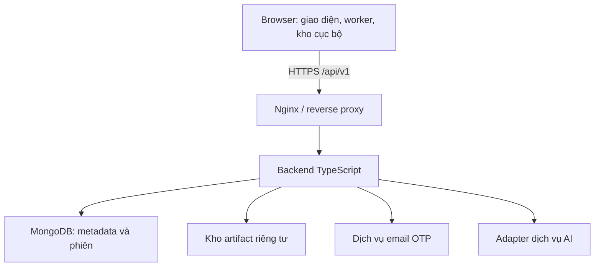

# Prompt giao nhiệm vụ cho Agent — Thiết kế backend

**Đề tài:** Xây dựng hệ thống dashboard tương tác 3D quản lý và trực quan hóa toàn bộ quy trình khai phá dữ liệu.

**Ngày cập nhật:** 02/11/2026. **Ngôn ngữ:** Tiếng Việt. **Trạng thái:** Đặc tả thiết kế và prompt triển khai sau này; chưa phải mã nguồn, hệ thống đã triển khai hay báo cáo kiểm thử.

## 1. Vai trò, nhiệm vụ và tài liệu căn cứ

Bạn là kiến trúc sư backend và kỹ sư TypeScript. Dựa trên đặc tả này, thiết kế backend đủ cụ thể để nhóm triển khai, kiểm thử và tích hợp frontend/offline/MongoDB/Nginx. Giải thích thuật ngữ khi xuất hiện lần đầu.

Đã đối chiếu nội dung bốn tài liệu:

1. `thiet_ke_chuc_nang_he_thong_.md`: nghiệp vụ và phạm vi ứng dụng.
2. `thiet_ke_caynut_dieukien.md`: operationId, điều kiện thao tác và loại đầu ra.
3. `thiet_ke_offline.md`: thực thi browser, lưu cục bộ, đồng bộ, nhiều tab và đăng xuất.
4. `thiet_ke_mongodb.md`: đối tượng lưu trữ, phiên bản, artifact, revision, commit và xóa.

Các quyết định bổ sung ở mục 2 được người dùng chốt trong cuộc trao đổi backend sau bốn tài liệu, thay thế các điểm tương ứng còn ghi “đề xuất/chưa chốt”. Không tự sửa bốn file nguồn. Nếu nhận phiên bản mới, đối chiếu nội dung thực tế trước khi thay đổi thiết kế. Chưa có file frontend/Nginx/3D hoàn chỉnh được đọc trong nhiệm vụ này; phần tích hợp với chúng là hợp đồng cần tuân theo, không phải tuyên bố đã đối chiếu.

Nhiệm vụ hiện tại là đặc tả. Không tự triển khai dịch vụ, tạo tài nguyên trả phí, gửi email thật hoặc sửa repository nếu chưa được giao triển khai riêng.

## 2. Yêu cầu đã chốt và quyết định kỹ thuật đề xuất

### 2.1. Yêu cầu đã chốt

| Nhóm | Quyết định |
| --- | --- |
| Môi trường | Website truy cập bằng link; người dùng không cài Node.js/MongoDB/Docker/Nginx |
| Ngôn ngữ | Frontend, backend, xử lý và thuật toán dùng JS/TS; không dùng Python trong ứng dụng |
| Tài khoản | Email và mật khẩu riêng của hệ thống, không phải mật khẩu hộp thư; xác minh đăng ký bằng OTP email |
| Quản lý tài khoản | Đăng ký, đăng nhập/đăng xuất, quên/đặt lại mật khẩu, xem thông tin, đổi tên hiển thị; chưa có xóa tài khoản |
| OTP | 6 chữ số, hết hạn sau 5 phút, dùng một lần, chờ 60 giây trước khi gửi lại, tối đa 5 lần nhập sai cho một mã |
| Đặt lại mật khẩu | OTP → quyền đặt mật khẩu mới → thu hồi tất cả phiên cũ; không xóa dữ liệu cục bộ chưa đồng bộ |
| Phiên | Một tài khoản có một phiên online hợp lệ; tab cùng browser profile dùng chung phiên; máy B đăng nhập thu hồi phiên A |
| Quyền | Tài nguyên riêng từng tài khoản; không chia sẻ/cộng tác hay phân vai admin/editor/viewer |
| Nơi tính toán | Parse CSV/JSON, thống kê, làm sạch, tiền xử lý, nối/ghép và năm thuật toán đều chạy trong browser cả khi online |
| Thuật toán bản đầu | Linear Regression, Logistic Regression, KNN phân lớp, K-Means, PCA |
| Backend | Xác thực, phân quyền sở hữu, lưu trữ, đồng bộ, kiểm tra dữ liệu gửi lên, trung gian AI, tài nguyên offline, xóa và vận hành |
| Nhập dữ liệu | CSV/JSON mới chỉ online; mỗi tệp tạo dataset mới, giữ nguyên byte nguồn; JSON chọn danh sách bản ghi và flatten object, chưa bung mảng |
| Nối/ghép | Chỉ online, chạy trong browser, tạo dataset dẫn xuất mới; inner/left join; giữ tất cả phiên bản nguồn |
| Phiên bản | Nội dung đã commit bất biến; xử lý tiếp từ bản cũ tạo nhánh; mỗi bước biến đổi thành công lưu riêng |
| Xóa | Chỉ online, xóa vĩnh viễn; chặn xóa dataset còn phụ thuộc ngoài phạm vi xóa |
| Xung đột | Dữ liệu giữ thành nhánh; cấu hình giữ bản máy chủ và bản sao xung đột từ local cho người dùng chọn |
| AI | Dịch vụ chung và API key riêng; người dùng chủ động đổi dịch vụ/key khi lỗi nếu có adapter hỗ trợ |
| API key riêng | Chỉ dùng trong phiên, không lưu lâu dài; cần nhập lại ở phiên mới |
| Lịch sử AI | Thông tin truy vết, đề xuất có cấu trúc, nội dung đã chấp nhận; không lưu nguyên văn toàn hội thoại |
| Số tài khoản | Tối đa 100 tài khoản đã kích hoạt |
| Đồng thời | 100 người dùng đồng thời là mục tiêu kiểm thử, chưa phải khả năng được bảo đảm |
| Dung lượng | Tệp đầu vào tối đa 20 MB; mục tiêu khoảng 10.000–50.000 dòng, khoảng 50 cột đầu vào; kiểm tra riêng dữ liệu sau parse/biến đổi |
| Phiên bản đầu ra | Không áp giới hạn nghiệp vụ cố định về số phiên bản/tổng dung lượng dự án; vẫn có kiểm tra tài nguyên và giới hạn kỹ thuật cấu hình được |
| Vận hành | Ưu tiên miễn phí trong đồ án; sao lưu thủ công trước demo/thay đổi lớn |

20 MB được đề xuất chuẩn hóa thành 20.000.000 byte và hiển thị đúng đơn vị; dòng/cột là mục tiêu kiểm thử, không tự biến thành trần cứng. Không ép mọi artifact đầu ra dưới 20 MB. Không hứa tài nguyên vô hạn.

### 2.2. Giải pháp kỹ thuật đề xuất cho bản đầu

Đây là lựa chọn kiến trúc của đặc tả, không phải framework người dùng đã chỉ định:

- Backend dạng **modular monolith**: một ứng dụng có các module rõ trách nhiệm; chưa tách microservice.
- Node.js bản LTS còn được hỗ trợ tại lúc triển khai, TypeScript, Fastify và MongoDB Node.js Driver chính thức. Chốt phiên bản chính xác và lockfile sau kiểm tra tương thích, không dùng nhãn `latest` không khóa trong bản triển khai.
- REST JSON dưới `/api/v1`; upload/download dùng luồng byte riêng. OpenAPI mô tả request/response và mã lỗi.
- Cookie phiên opaque: chuỗi ngẫu nhiên không mang quyền tự chứng minh; server kiểm tra trạng thái phiên. Không cần JWT dài hạn trong localStorage.
- MongoDB lưu metadata; artifact lưu qua adapter kho file riêng tư, bền vững. Kho provider cụ thể chưa chọn.
- Một instance backend ở bản đầu; tác vụ bảo trì có trạng thái bền vững trong MongoDB. Chưa yêu cầu Redis, message broker hoặc cụm nhiều instance.
- Frontend/worker và backend chia sẻ hợp đồng thuần TS/JSON Schema; không đưa mã Node.js, secret hay driver MongoDB vào bundle browser.

Fastify hỗ trợ validation/serialization theo schema [S1]. Schema phải do ứng dụng kiểm soát, không biên dịch schema tùy ý nhận từ người dùng. Các lựa chọn trên nhằm giảm số dịch vụ cần vận hành, không phải cam kết hiệu năng.

## 3. Kiến trúc và ranh giới trách nhiệm



| Thành phần | Phụ trách | Hợp đồng với backend |
| --- | --- | --- |
| Giao diện | Nhập cấu hình, preview, xin xác nhận, thông báo trạng thái | Không tự quyết quyền hoặc coi mạng có sẵn là phiên hợp lệ |
| Worker browser | Parse, xử lý, thuật toán, tiến độ và hủy | Gửi kết quả hoàn chỉnh cùng nguồn/cấu hình; không cần server chạy lại |
| Kho cục bộ/offline | Commit local, outbox bền vững, một writer/project, mở lại, cache | Chỉ xóa mục outbox đã ACK đúng nội dung; chờ người dùng sau mất mạng |
| Backend | Quyền, validation, artifact, revision, commit, receipt và API AI | Không báo kết quả client là đã được server tính lại/xác minh metric |
| MongoDB | Metadata, quan hệ, phiên và các trạng thái bền vững | Không lưu toàn bảng/log tăng vô hạn trong một document |
| Kho file | Byte nguồn, phiên bản bảng, mô hình, ma trận và PDF | Không công khai URL vĩnh viễn; kiểm tra chủ sở hữu trước tải |
| Nginx | HTTPS/routing, giới hạn truyền tải, phục vụ tài nguyên ứng dụng | Không cache công khai API riêng tư; không thay validation backend |

Không tạo endpoint chạy thuật toán backend cho năm thuật toán browser. Tạo PDF và xuất dữ liệu/biểu đồ ở browser theo tài liệu chức năng; backend chỉ nhận báo cáo/artifact khi người dùng chọn lưu. Không bắt tải PDF về phải lưu thành report.

## 4. Tổ chức mã nguồn đề xuất

```text
apps/
  web/                          # Giao diện, offline và worker browser
  api/
    src/
      app.ts                    # Khởi tạo ứng dụng, có thể dùng trong integration test
      server.ts                 # Listen và graceful shutdown
      config/                   # Đọc/kiểm tra cấu hình, không chứa secret thật
      plugins/                  # Mongo, session, CSRF, lỗi, log, rate limit
      modules/
        auth/                   # Đăng ký, OTP, reset, phiên, profile
        projects/
        datasets/               # Metadata, versions, branches, lineage
        resources/              # Workflow, chart, dashboard, model, report, run
        artifacts/              # Upload staging, hash, download và cleanup
        sync/                   # Batch, mutation, commit, receipt, conflict
        ai/                     # Context, validation, adapter, key tạm
        deletion/               # Phụ thuộc, tombstone và dọn file
        maintenance/            # Cleanup/reconciliation có lease
        health/
      infrastructure/           # Mail/storage adapters, clock, random, providers
    tests/
packages/
  contracts/                    # DTO, lỗi, schema, OpenAPI dùng chung
  operation-registry/           # operationId, configVersion, loại đầu ra
  data-format/                  # Serializer/manifest thuần JS/TS dùng chung
docs/
  api/                          # OpenAPI, ví dụ payload và luồng
  operations/                   # Deploy, backup, restore và demo
```

Trong mỗi module: `routes` nhận HTTP → `service` xử lý nghiệp vụ → `repository` truy cập MongoDB. Không để route tự xây truy vấn tùy ý từ body. Module resources được tách file/service theo đối tượng; không tạo một collection/module cho mỗi nút.

Các mutation tài nguyên đồng bộ đi qua một service commit dùng chung. Không có đường CRUD khác bỏ qua revision, receipt, session fence hoặc tombstone. API sửa tên profile là ngoại lệ không thuộc dự án, vẫn phải có validation và kiểm soát phiên.

## 5. Đăng ký, OTP và giới hạn tài khoản

### 5.1. Đăng ký

1. Browser gửi email, tên hiển thị, mật khẩu hệ thống và xác nhận mật khẩu qua HTTPS.
2. Chuẩn hóa email theo quy tắc thống nhất, giữ giá trị hiển thị; không tự bỏ dấu chấm hoặc phần `+tag`. Kiểm tra tên và mật khẩu; đề xuất mật khẩu 15–128 ký tự, cho phép khoảng trắng/Unicode, không trim hoặc cắt mật khẩu.
3. Tạo đăng ký chờ với password hash, không lưu mật khẩu gốc. Đề xuất Argon2id với tham số đo phù hợp máy chủ [S2]. Hashing có giới hạn đồng thời để tránh cạn tài nguyên.
4. Tạo OTP bằng bộ sinh số ngẫu nhiên mật mã, lưu verifier HMAC có secret phía server và ràng buộc challengeId/purpose/email/generation. Không lưu OTP nguyên văn; mã ngắn không được chỉ hash không khóa rồi coi là chống dò ngoại tuyến.
5. Gửi email qua MailAdapter. Chỉ phản hồi trạng thái gửi phù hợp thực tế: provider chấp nhận không chứng minh thư đã vào hộp thư. Nếu gửi lỗi, cho thử lại theo cooldown, không kích hoạt tài khoản.
6. Khi xác minh, kiểm tra hết hạn, số lần sai, purpose, generation, consumedAt; tăng số lần sai nguyên tử. Mã mới vô hiệu mã cũ; mã đã dùng không dùng lại.
7. Kích hoạt tài khoản và tiêu thụ OTP trong transaction. Kiểm tra email duy nhất và tăng bộ đếm tài khoản bằng điều kiện `< 100` cùng transaction; hai xác minh đồng thời không được vượt 100.
8. Đăng ký chờ không chiếm vĩnh viễn một suất. Khi đủ 100 tài khoản, không kích hoạt thêm; không xóa tài khoản cũ để nhường chỗ. Đề xuất sau xác minh yêu cầu đăng nhập, không tự tạo phiên mới.

Người đã có tài khoản không bị một đăng ký chờ khác thay mật khẩu. Việc gửi lại mã không thay password hash/tên của challenge cũ từ một yêu cầu không chứng minh quyền. Pending registration có thời hạn dọn đề xuất 24 giờ; OTP vẫn chỉ có hiệu lực 5 phút. TTL chỉ hỗ trợ dọn rác, nghiệp vụ luôn tự kiểm tra thời hạn.

### 5.2. Quên và đặt lại mật khẩu

- Yêu cầu quên mật khẩu trả thông báo chung, không tiết lộ email có tài khoản hay không; chống spam theo IP, email chuẩn hóa và challenge [S3].
- OTP reset riêng purpose, không dùng mã đăng ký để reset. Đúng OTP tạo reset grant ngẫu nhiên, dùng một lần, chỉ có quyền đặt mật khẩu mới; đề xuất hết hạn 5 phút. Không dùng trực tiếp email hoặc cờ boolean từ client làm quyền reset.
- Commit mật khẩu mới, tiêu thụ grant và tăng session epoch trong cùng transaction. Reset grant cũ ràng buộc password/auth generation; không được dùng lại sau một lần reset khác.
- Thu hồi mọi phiên cũ, xóa key AI tạm gắn phiên, không tự đăng nhập sau reset. Không xóa dữ liệu cục bộ của thiết bị bị thu hồi.
- Rate limit đề xuất ban đầu: mỗi email/purpose tối đa 5 lần gửi OTP/giờ, có thêm giới hạn theo IP; ngưỡng IP và login tuning qua kiểm thử. Cooldown 60 giây và tối đa 5 lần sai/mã là yêu cầu đã chốt, không được nới khi retry hoặc gửi đồng thời.
- Không khóa vĩnh viễn tài khoản chỉ vì người khác liên tục gọi quên mật khẩu. Không ghi mật khẩu/OTP/reset grant vào log.

Bản đầu không có đổi email, xóa tài khoản hoặc thay mật khẩu trực tiếp trong profile. Người dùng muốn đặt lại mật khẩu dùng luồng quên mật khẩu đã xác minh email.

## 6. Phiên đăng nhập, bảo vệ request và thu hồi

### 6.1. Phiên máy chủ

- Sau kiểm tra mật khẩu, tạo token phiên ngẫu nhiên; lưu hash token, ownerId, sessionId, authEpoch, thời hạn và trạng thái. Cookie `HttpOnly`, `Secure` ở production, `SameSite=Lax`, Path nhất quán; ưu tiên cùng origin qua Nginx [S4].
- Đề xuất tuổi thọ online tuyệt đối 7 ngày, cấu hình được và thể hiện bằng expiresAt; không tự gia hạn vô hạn. Offline entitlement là quyền cục bộ riêng, không phải cookie online còn hạn.
- Đăng nhập B tăng epoch và tạo phiên mới nguyên tử; phiên A hết quyền gọi API ngay khi request/commit kiểm tra thấy epoch cũ. Không chỉ chờ TTL xóa session.
- Các tab cùng profile dùng chung cookie, không tạo phiên mới khi mở tab. Đăng nhập lại chủ động là đăng nhập mới; frontend điều phối các tab để không login trùng.
- Mọi request riêng tư kiểm tra user/session/epoch/expiry/owner. Request mutation kiểm tra lại trong commit. Các transaction ghi dự án phải có thao tác cập nhật có điều kiện lên bản ghi user/session fence mà login/logout/reset cũng cập nhật; đọc epoch rồi ghi đối tượng khác trong snapshot là chưa đủ để chống race thu hồi.
- Nếu commit và thu hồi tranh nhau, transaction fence khiến chúng có thứ tự: commit trước thu hồi có thể đã tồn tại; commit sau thu hồi phải bị chặn. Retry transaction phải kiểm tra lại trạng thái hiện hành, không tái dùng kết luận quyền cũ.
- Kiểm tra Origin/CSRF token cho mutation dùng cookie, kể cả login/logout và tạo AI context; CORS allowlist theo origin triển khai. Không chấp nhận `ownerId` client làm nguồn quyền.

### 6.2. Đăng xuất và offline

| Tình huống | Hành vi |
| --- | --- |
| Offline, có thay đổi chờ | Chặn đăng xuất, có Hủy |
| Offline, không có thay đổi chờ | Xóa dữ liệu tài khoản local; giữ yêu cầu tối thiểu thu hồi đúng phiên cũ khi có mạng |
| Online, có thay đổi chờ | Đồng bộ rồi đăng xuất / Vẫn đăng xuất / Hủy |
| Đồng bộ trước logout lỗi | Giữ dữ liệu và trạng thái làm việc |
| Vẫn đăng xuất | Xác nhận mất phần chưa đồng bộ; dừng writer/worker, thu hồi và xóa local |
| Online, không có thay đổi chờ | Thu hồi, xóa dữ liệu tài khoản local |

Frontend phải điều phối tất cả tab, dừng tác vụ và chụp đúng tập thay đổi trước quyết định. Backend không biết những thay đổi chưa từng gửi nên không được tự khẳng định local đã sạch.

Đề xuất cấp revocation handle ngẫu nhiên chỉ có quyền thu hồi đúng sessionId cũ khi đăng nhập. Client giữ tối thiểu handle này trong hàng đợi thu hồi offline; không dùng nó đọc/ghi dự án. Endpoint nhận handle phải idempotent, không cần cookie của phiên mới và không bao giờ thu hồi phiên khác. Khi phiên cũ đã hết hiệu lực, trả kết quả an toàn rồi client xóa handle. Không dùng một request “logout tài khoản hiện tại” để thực hiện thu hồi chờ của phiên cũ.

Phiên hết hạn/thu hồi chỉ chặn API, không yêu cầu frontend xóa outbox. Đăng nhập lại đúng owner trước đồng bộ; account khác không được đọc hay nhận đồng bộ dữ liệu đang giữ. Không gọi `Clear-Site-Data` toàn bộ chỉ vì nhận 401, vì có thể làm mất dữ liệu chưa đồng bộ.

## 7. Hợp đồng dữ liệu và validation

- ID đồng bộ đề xuất UUID dạng chuỗi tạo được offline; dùng nhất quán trong TS/JSON/MongoDB. V0/V1 là nhãn hiển thị, không là khóa toàn cục.
- Dùng `schemaVersion`, `configVersion`, `operationId` và phiên bản serializer. Revision do server kiểm soát, dùng compare-and-set; timestamp client chỉ là thông tin, không quyết định ghi đè.
- Nguồn tính toán luôn có `executionLocation: browser`, version nguồn, operation snapshot, seed nếu hỗ trợ, phiên bản engine/thư viện và schema đầu ra. Metric client gửi là kết quả do client báo cáo; không gọi là server-verified.
- Phân biệt `parentVersionId` trong dataset với `sourceVersions[]` của nối/ghép. Không cho chu trình lineage hoặc tham chiếu sang tài khoản/dự án khác.
- Cột/dòng có ID ổn định hoặc mapping tương đương; đổi tên cột không làm mất tham chiếu. Kết quả join giữ mapping nhiều nguồn; mapping lớn lưu artifact.
- Hợp đồng serializer phải mô tả null, number hữu hạn, boolean, string, date, số lớn và ma trận thưa. Không âm thầm chuyển NaN/Infinity thành null hoặc ép số lớn mất chính xác.
- Model chứa đặc trưng, nhãn, split, tiền xử lý đã fit, tham số và metric. PCA mặc định là artifact tọa độ/phương sai; áp dụng vào bảng là operation khác. Backend không ép mọi kết quả thành dataset version.
- Danh mục thao tác dùng chung quy định loại `view/version/artifact/config/control`, tham số cho phép và điều kiện. AI cũng dùng cùng validator; không tự thêm phương pháp chưa chốt.
- Server kiểm tra shape, owner, nguồn, lineage, schema, giới hạn, tính đầy đủ file; không tính lại toàn bộ thuật toán. Kiểm tra nội dung artifact theo định dạng bằng streaming/bounded parser khi cần; không load tất cả lên RAM.
- Không nhận Mongo filter/update, biểu thức `eval`, JS hoặc schema thực thi tùy ý. Biểu thức tạo đặc trưng dùng ngôn ngữ giới hạn phía engine browser; server chỉ chấp nhận cấu trúc/operation đã cho phép.

## 8. Nhập dữ liệu, artifact và dung lượng

### 8.1. Luồng nhập online

1. Kiểm tra máy chủ và phiên, project đang tồn tại; server cấp import intent gắn owner/project/session và ID ổn định.
2. Browser parse/preview CSV/JSON trong worker; người dùng xác nhận cấu hình. Không bỏ dòng lỗi hoặc mảng JSON ngầm.
3. Browser lưu local byte gốc, V0, parse config, schema và mục chờ theo commit nguyên tử của module offline.
4. Upload file gốc/V0, commit dataset qua service đồng bộ. Chỉ công bố tài nguyên server sau khi đủ artifact. Nếu mất mạng, giữ phần đã lưu local cùng intent để retry; không bắt đầu import mới offline.
5. Hiển thị chính xác “đã lưu trên máy/chưa đồng bộ” hoặc “đã đồng bộ”; lỗi trước local commit không được nhận dataset hoàn chỉnh. Bản dở có trạng thái riêng.

Dataset dẫn xuất từ nối/ghép dùng intent online tương tự, giữ mọi nguồn và không giả tạo file upload của người dùng. Intent ngắn hạn có thời hạn; nếu hết hạn trước commit, xác thực và xin cấp lại khi online với cùng tài nguyên logic/chống gửi trùng, không tự tạo dataset thứ hai. Thao tác đang chạy gặp mất mạng được xử lý như kết quả local đang chờ; không cấp phép khởi chạy mới offline.

### 8.2. Vòng đời artifact

`declared → uploading → verifying → ready`; lỗi/hủy có trạng thái riêng; `deleting → deleted` cho dọn file. Trạng thái ready chỉ đạt khi nội dung đã kiểm tra và gắn tham chiếu trong commit.

- Server tạo uploadId/storage key, ràng buộc owner/project/purpose/size/hash; không nhận đường dẫn file tùy ý từ client.
- Hỗ trợ chunk có index/offset, hash chunk nếu dùng, tổng kích thước và hash toàn file; retry chunk không nhân byte. Nguồn 20 MB và artifact đầu ra là hai loại giới hạn khác nhau.
- Hash do server kiểm chứng, không chỉ tin hash client. Cùng ID artifact khác nội dung bị từ chối. Không dùng hash chung để lộ file của tài khoản khác.
- Kho phải riêng tư, bền vững. Backend stream download có quyền ở bản đầu; signed URL là mở rộng cần xét thời gian sống và giới hạn thu hồi, không được hứa thu hồi tức thời URL đã cấp.
- Upload không giữ transaction DB mở. Khi finalize, kiểm tra session fence, tombstone, quyền, tham chiếu và revision rồi mới công bố. Artifact hoàn tất byte nhưng chưa có reference vẫn là staging, chưa là version thành công.
- Dọn staging/orphan có khoảng an toàn, kiểm tra lease và reference, có retry; tránh xóa file vừa được commit hoặc còn dùng chung. Lỗi storage sau commit phải được reconciliation phát hiện và báo thiếu tài nguyên, không che lỗi.

### 8.3. Không có quota nghiệp vụ không đồng nghĩa vô hạn

Không đặt trần cố định số phiên bản hoặc tổng dung lượng dự án; không tự xóa lịch sử. Vẫn cấu hình giới hạn request metadata, chunk, bộ nhớ parser, kích thước artifact theo khả năng thực tế và số upload đồng thời. Trước demo đo và công bố ngưỡng, không để biến cấu hình không có giá trị hoặc `Infinity`.

Nếu storage nhà cung cấp hết dung lượng: từ chối nhận/commit mới với mã lỗi rõ, giữ server commit cũ, client giữ local/outbox. Nếu local cũng không lưu được, giữ version hoàn chỉnh trước đó và không báo kết quả mới thành công. Không hạ mẫu, cắt đặc trưng hoặc loại dòng ngầm để vượt kiểm tra.

## 9. Đồng bộ, receipt và xung đột

### 9.1. Trình tự

Online liên tục: commit local trước, tự đồng bộ sau. Sau mất mạng/server không truy cập được: client chờ người dùng bấm “Đồng bộ ngay”; không tab khác tự vượt chờ. Thành công mới bật lại tự đồng bộ. Backend xử lý snapshot client gửi, không tự biết outbox mới phát sinh.

1. Client kiểm tra phiên đúng owner, chụp tập mutation hoàn chỉnh.
2. Tạo batch/khai báo dependency và artifact; server trả phần đã có, phần cần upload.
3. Client upload phần thiếu; server xác minh.
4. Commit mutation theo nhóm phụ thuộc có giới hạn; kiểm tra epoch, ownership, tombstone, base revision, version nguồn và completeness.
5. Ghi đối tượng/version, head/cursor, artifact references và receipt trong transaction phù hợp.
6. ACK chính xác mutationId, objectId, artifactId, revision và conflict nếu có. Client chỉ xác nhận những mục thuộc ACK, giữ mục khác chờ.

```json
{
  "batchId": "uuid-batch",
  "schemaVersion": 1,
  "deviceId": "uuid-device",
  "mutations": [{
    "mutationId": "uuid-mutation",
    "kind": "dataset.version.create",
    "projectId": "uuid-project",
    "entityId": "uuid-version",
    "baseRevision": 4,
    "payloadHash": "sha256-of-canonical-payload",
    "dependencies": ["uuid-parent-version"],
    "payload": {
      "datasetId": "uuid-dataset",
      "parentVersionId": "uuid-parent-version",
      "branchId": "uuid-branch",
      "operationId": "CLEAN.HTML",
      "configVersion": 1,
      "artifactId": "uuid-table-artifact"
    }
  }]
}
```

Tên operation trong ví dụ minh họa phải được đối chiếu mã thực tế ở registry khi triển khai; không tạo alias khác nhau ở các module. Với tạo version, `baseRevision` thuộc đầu nhánh mục tiêu; với sửa cấu hình, thuộc cấu hình đó. Revision snapshot project dùng cho manifest/cursor, không buộc đổi tên chart không liên quan làm xung đột mọi dataset.

```json
{
  "data": {
    "batchId": "uuid-batch",
    "status": "partial",
    "acknowledged": [{"mutationId": "uuid-mutation", "entityId": "uuid-version", "revision": 5}],
    "pending": [{"mutationId": "uuid-other", "code": "ARTIFACT_NOT_READY"}],
    "conflicts": [],
    "cursor": "opaque-server-cursor"
  },
  "requestId": "server-request-id"
}
```

### 9.2. Chống gửi trùng và transaction

- Unique ownerId + mutationId; canonical payload/hash do server tính theo hợp đồng dùng chung. Cùng mutationId khác nội dung trả `IDEMPOTENCY_MISMATCH`.
- Mất ACK sau commit: query receipt hoặc retry trả kết quả tương đương, không thêm version/chart/model/bản sao xung đột.
- Batch có thể partial: nhóm độc lập thành công được ACK; nhóm còn thiếu dependency không được commit. Một nhóm mutation phụ thuộc nguyên tử không được ACK một nửa; không transaction toàn lịch sử lớn.
- MongoDB multi-document transaction cần deployment replica set hoặc sharded cluster [S5]; cấu hình dev/test phải hỗ trợ transaction. Không triển khai standalone rồi bỏ kiểm tra nguyên tử.
- Callback transaction có thể được retry; không gửi email, gọi AI hoặc ghi file không idempotent bên trong callback. Không chờ upload/tính toán trong transaction.
- Receipt có thời hạn lưu cấu hình được. Khi receipt/cursor đã hết hạn, bắt đối chiếu manifest và danh tính tài nguyên/lineage trước retry; không nhận lại vô điều kiện như mutation mới. Giữ ID đối tượng và generation chống tái sinh.

### 9.3. Xung đột

| Đối tượng | Xử lý |
| --- | --- |
| Đầu nhánh dataset thay đổi | Giữ server head; commit local thành nhánh riêng cùng nguồn; trả liên kết hai nhánh |
| Workflow/chart/dashboard thay đổi | Giữ server; tạo bản sao cấu hình local có ID ổn định gắn mutationId và conflictOf; không tự đổi dashboard sang bản sao |
| Con trỏ mở lại/version hiện tại | Giữ lựa chọn local theo thiết bị, báo khác biệt; không ghi đè tiến độ local chưa đồng bộ |
| Tài nguyên đã xóa | Không tạo nhánh/bản sao để làm sống lại; trả RESOURCE_DELETED, giữ dữ liệu local chờ giải quyết |

Người dùng có thể chọn bản sao cấu hình để tiếp tục hoặc chủ động cập nhật bản gốc qua mutation mới có revision mới. Không tự merge JSON, không last-write-wins theo đồng hồ client. Nội dung version cùng ID khác hash là lỗi bất biến, không phải xung đột có thể ghi đè.

## 10. API contract đề xuất

### 10.1. Quy ước chung

Request/response có schema và ví dụ trong OpenAPI; giới hạn độ dài, phân trang cursor, sort/filter allowlist. Thành công dùng `{data, requestId}`; lỗi dùng `{error:{code,message,details,retryable},requestId}`. Không lộ stack, secret, storage key hoặc sự tồn tại tài nguyên của owner khác. Truy vấn tài nguyên khác owner có thể trả 404 thống nhất.

Đọc danh sách mặc định đề xuất 20, tối đa 100 phần tử/trang; trang lịch sử không chứa toàn artifact. Thời gian server dùng UTC ISO 8601, giao diện chuyển múi giờ. Mutation dùng ID chống gửi trùng; cập nhật đối tượng mutable dùng baseRevision/If-Match nhất quán.

### 10.2. Danh sách endpoint

| Method / đường dẫn dưới `/api/v1` | Request chính | Kết quả/quyền |
| --- | --- | --- |
| POST `/auth/register` | email, displayName, password, confirmPassword | Challenge đăng ký; chưa có quyền dự án |
| POST `/auth/otp/resend` | challengeId, purpose | Gửi lại nếu đủ cooldown/rate limit; đổi generation |
| POST `/auth/register/verify` | challengeId, otp | Kích hoạt nếu còn suất; không tự login |
| POST `/auth/login` | email, password | Cookie phiên mới, thu hồi phiên cũ, revocation handle |
| GET `/auth/session` | Cookie | User/session hiện tại, expiresAt; không trả token hash |
| POST `/auth/password/forgot` | email | Phản hồi chung và challenge opaque |
| POST `/auth/password/verify` | challengeId, otp | Reset grant ngắn hạn, không có quyền dự án |
| POST `/auth/password/reset` | resetGrant, password, confirmPassword | Đổi hash, tiêu thụ grant, thu hồi các phiên |
| POST `/auth/logout` | Cookie, CSRF | Thu hồi đúng phiên; idempotent |
| POST `/auth/revoke-deferred` | sessionId, revocationHandle | Chỉ thu hồi phiên cũ được chỉ định |
| GET / PATCH `/me` | Cookie; displayName cho PATCH | Profile an toàn; không cho đổi owner/email bằng PATCH |
| GET / POST `/projects` | Cursor; tên + mutationId khi tạo | Danh sách owner; tạo chỉ khi server/phiên hợp lệ |
| GET `/projects/:id` | Project ID | Metadata và tham chiếu mở lại, không tải hết lịch sử |
| GET `/projects/:id/manifest` | snapshotId/cursor nếu phân trang | Manifest tài nguyên tại snapshot nhất quán |
| GET `/projects/:id/changes` | Change cursor | Thay đổi/tombstone có phân trang hoặc yêu cầu resync |
| GET `/projects/:id/datasets` | Cursor | Dataset cùng project/owner |
| POST `/projects/:id/import-intents` | ID ổn định, file info hoặc nguồn dẫn xuất | Cấp intent online cho nhập/nối/ghép |
| GET `/datasets/:id/versions` | Cursor, branchId | Version bất biến và lineage |
| GET `/datasets/:id/branches` | Dataset ID | Danh sách nhánh, conflict/source |
| GET `/versions/:id` | Version ID | Schema và artifact references có quyền |
| GET `/projects/:id/resources` | Loại cho phép, cursor | Workflow/chart/dashboard/model/report/run metadata |
| GET `/resources/:id` | Resource ID | Snapshot/cấu hình có quyền, không tự đổi nguồn |
| GET `/runs/:id/steps` | Cursor | Run/step do browser báo cáo, phân trang |
| POST `/sync/batches` | Batch ID, schemaVersion, mutation/artifact manifest | Kế hoạch upload, validation và batch state |
| POST `/artifacts/uploads` | Batch, purpose, size, hash | uploadId, cấu hình chunk, expiry |
| PUT `/artifacts/uploads/:id/chunks/:index` | Byte/chunk metadata | Xác nhận chunk; retry không nhân byte |
| POST `/artifacts/uploads/:id/complete` | Tổng/hash | Verified staging hoặc lỗi; chưa công bố version |
| GET `/artifacts/uploads/:id` | Upload ID | Trạng thái và chunk đã nhận |
| DELETE `/artifacts/uploads/:id` | Upload ID | Hủy staging đúng owner, không xóa ready đang dùng |
| GET `/artifacts/:id/content` | Artifact ID | Stream có quyền, không cache công khai |
| POST `/sync/batches/:id/commit` | Danh sách mutation đã khai báo | ACK/partial/conflict, có fence |
| GET `/sync/batches/:id` | Batch ID | Trạng thái và ACK có phân trang nếu lớn |
| GET `/sync/receipts/:mutationId` | Mutation ID | Receipt của owner hoặc yêu cầu đối chiếu lại |
| GET `/projects/:id/conflicts` | Cursor | Nhánh/bản sao cấu hình cạnh tranh |
| POST `/projects/:id/deletion-plan` | Phạm vi xóa, baseRevision | Phụ thuộc, tài nguyên, plan token và expiry |
| POST `/projects/:id/deletions` | Plan token, xác nhận, mutationId | Xóa logic/fence rồi trả deletion job ID |
| GET `/deletions/:id` | Job ID | deleting/completed/failed và tiến độ dọn |
| GET `/ai/providers` | Cookie | Adapter/model có thể dùng, hạn mức/trạng thái chung; không secret |
| POST / DELETE `/ai/session-context` | Provider, key riêng khi POST | Handle tạm gắn phiên; DELETE xóa key tạm |
| POST `/ai/requests` | requestId, context đã duyệt, task, nguồn | Đề xuất có cấu trúc/validation; không thực thi thao tác |
| GET `/ai/requests/:id` | Request ID | Trạng thái/đề xuất ngắn hạn phục vụ retry, không hội thoại toàn văn |
| POST `/ai/requests/:id/cancel` | Request ID | Hủy/đánh dấu hủy; không hứa provider không tính phí |
| GET `/health/live` | Không cần user | Tiến trình còn sống, thông tin tối thiểu |
| GET `/health/ready` | Theo cấu hình giám sát | Phụ thuộc cốt lõi sẵn sàng; không lộ credentials |

Đổi tên dự án, lưu workflow/chart/dashboard/model/report, đổi con trỏ làm việc, chọn nhánh và lưu AI đã chấp nhận dùng mutation trong `/sync`, không tạo API ghi thứ hai. POST tạo project cũng gọi cùng commit service với receipt. Danh mục mutation phải được định nghĩa kiểu cụ thể, không endpoint upsert tùy ý mọi collection.

### 10.3. Mã lỗi chính

| HTTP | Mã nghiệp vụ tiêu biểu | Client xử lý |
| --- | --- | --- |
| 400/422 | VALIDATION_FAILED, UNSUPPORTED_OPERATION, INVALID_SOURCE | Sửa đúng trường/bước, không tự bỏ dữ liệu |
| 401 | AUTH_REQUIRED, SESSION_EXPIRED, SESSION_REVOKED | Giữ local; đăng nhập đúng owner trước sync |
| 403/404 | FORBIDDEN hoặc RESOURCE_NOT_FOUND | Không tiết lộ tài nguyên owner khác |
| 409 | REVISION_CONFLICT, IDEMPOTENCY_MISMATCH, DEPENDENCY_EXISTS, ACCOUNT_LIMIT_REACHED | Hiện xung đột/phụ thuộc; không retry mù |
| 410 | RESOURCE_DELETED, CURSOR_EXPIRED | Giữ local, đối chiếu an toàn; không tái tạo cùng ID |
| 413 | INPUT_FILE_TOO_LARGE, ARTIFACT_LIMIT_EXCEEDED, PAYLOAD_TOO_LARGE | Phân biệt input 20 MB và ngưỡng artifact kỹ thuật |
| 422 | OTP_INVALID, OTP_EXPIRED, OTP_ATTEMPTS_EXCEEDED, ARTIFACT_NOT_READY, HASH_MISMATCH | Không commit, hướng dẫn xử lý |
| 429 | RATE_LIMITED, AI_QUOTA_EXCEEDED | Có Retry-After khi biết; không retry liên tục |
| 503 | STORAGE_CAPACITY_EXCEEDED, STORAGE_UNAVAILABLE, MAIL_UNAVAILABLE, AI_UNAVAILABLE | Giữ outbox/kết quả cũ; chọn thử lại phù hợp |
| 409/422 | CLIENT_SCHEMA_UNSUPPORTED | Yêu cầu cập nhật có bảo toàn local, không xóa outbox |

Phân biệt lỗi xác thực endpoint OTP với việc tiết lộ tài khoản: thông báo quên mật khẩu vẫn chung, lỗi challenge chỉ phản ánh quyền/challenge đã cấp. Khi conflict được giữ thành công thành nhánh/bản sao thì ACK mô tả kết quả đó, không trả lỗi khiến client lặp tạo bản sao.

## 11. AI và API key chỉ dùng trong phiên

### 11.1. Adapter và bí mật

- AI provider/model dùng chung chưa chọn; key hệ thống chỉ nằm trong secret cấu hình backend. Mail provider và storage provider cũng chưa chọn; không tuyên bố gói miễn phí đủ tải khi chưa kiểm tra.
- Key người dùng chỉ tồn tại trong RAM browser và RAM backend khi cần, gắn sessionId/epoch/provider và handle ngẫu nhiên. Không ghi MongoDB, file, localStorage, IndexedDB, cache, log, analytics hoặc backup.
- Đề xuất key context hết hạn tối đa 30 phút không hoạt động và không vượt session expiry; logout/reset/thu hồi/đổi key phải xóa hoặc từ chối sử dụng ngay. Backend restart mất key, client nhập lại; không coi đây là lỗi mất dữ liệu dự án. Reload browser có thể phải nhập lại; không cam kết giữ key qua đóng tab.
- Các tab chỉ chia sẻ trạng thái có key qua handle thuộc phiên, không broadcast key nguyên văn. Handle không hoạt động nếu thiếu phiên đúng owner/epoch. Bản đầu một instance; nếu mở rộng nhiều instance, phải thiết kế lại key tạm, không tự ghi key vào DB để tiện triển khai.
- Provider/endpoint nằm trong allowlist cấu hình, không gọi URL tùy ý do người dùng nhập. Chống SSRF; không gửi key A sang provider B. HTTPS, timeout và giới hạn request/response bắt buộc.
- Nếu hỗ trợ đổi dịch vụ, người dùng chủ động chọn provider/model/key mới. Không tự chuyển sang key chung hoặc provider khác, không phát sinh phí ngoài lựa chọn đã duyệt.

### 11.2. Dữ liệu gửi và kết quả

1. Phân loại task: giải thích, gợi ý xử lý/thuật toán/biểu đồ/kết quả, điền văn bản thiếu.
2. Browser dựng context tối thiểu. Metadata/thống kê có thể đủ; nội dung từng dòng phải hiển thị chính xác mẫu/ngữ cảnh sẽ gửi và nhận đồng ý cho payload cụ thể.
3. Request chứa context hash, nguồn version, task, provider/model đã chọn và ghi nhận đồng ý nếu có row content. Đổi context làm mất hiệu lực đồng ý cũ. Không ngầm lấy toàn dataset từ artifact server để bổ sung prompt.
4. Backend kiểm tra quyền nguồn, kích thước, schema, hạn mức và phiên; không tin dữ liệu/AI là lệnh hệ thống. Output theo schema, operation/column allowlist; không eval, không tự gọi API xử lý/xóa.
5. Trả đề xuất để người dùng xem/chỉnh/chấp nhận. Chấp nhận cấu hình không đồng nghĩa đã chạy. Lần áp dụng thật vẫn qua validator và người dùng điều khiển.
6. AI điền văn bản chỉ là đề xuất có nguồn, có thể giữ missing nếu thiếu căn cứ. Không đưa mean/median vào văn bản để cố có giá trị.
7. Lưu audit tối thiểu: task, nguồn, provider/model, context hash, thời điểm, trạng thái, đề xuất có cấu trúc và liên kết phần chấp nhận/run. Không lưu nguyên hội thoại hoặc row payload đã gửi. Không lưu lại prompt chứa row content trong error trace.

Đề xuất cấu trúc cần để người dùng duyệt có thể lưu tạm có TTL/giới hạn, không phải lịch sử hội thoại vĩnh viễn. Phần bị bỏ qua được dọn theo chính sách, audit tối thiểu vẫn đủ truy vết trạng thái. Giá trị AI đã chấp nhận được lưu cùng nguồn trong version/operation snapshot.

Gọi AI có requestId chống gửi lặp, trạng thái running/succeeded/failed/cancelled/unknown. Khi timeout không biết provider đã thực hiện chưa, báo unknown thay vì tự gọi lại có thể tính phí hai lần. Thu hồi phiên giữa request chặn nhận/lưu kết quả về tài khoản qua phiên cũ; provider có thể đã nhận dữ liệu và không bảo đảm thu hồi được.

## 12. Manifest offline, phiên bản và lịch sử chạy

- Manifest phải chụp snapshot tham chiếu bất biến, có snapshotId/revision, artifactId/hash/size/format, dependency và phân trang. Các trang cùng snapshot không được trộn revision mới; snapshot hết hạn thì khởi tạo lại có giải thích.
- Mở dự án thông thường chỉ lấy metadata cần thiết/file gốc/current version. “Lưu để dùng offline” lấy toàn bộ tài nguyên dự án đã hoàn thành ở snapshot, gồm versions, workflow/run/step, chart/dashboard/model và PDF đã lưu.
- Thư viện/worker/app shell là tài nguyên ứng dụng công khai theo build; private manifest không thay cache ứng dụng. Frontend tự kiểm chứng đủ byte local trước báo sẵn sàng; server không biết cache có bị xóa sau tải hay không.
- Một writer/project do module offline điều phối. Backend không dùng khóa server để hứa chặn một máy đang offline; vẫn kiểm tra revision/session/lineage.
- Run/step do browser tạo có snapshot khóa cấu hình. Trạng thái chạy khác lưu và đồng bộ. Mỗi bước biến đổi commit version riêng; hủy/lỗi bước sau giữ bước trước.
- Refresh/đóng tab làm phần browser chưa hoàn thành bị gián đoạn; backend không chạy tiếp thuật toán. Khi mở lại client khôi phục local commit gần nhất rồi báo run interrupted phù hợp. Server không suy diễn một run thất bại chỉ vì mất mạng.
- Thống kê, model, PCA và chart tạo đúng loại output. Thay version hiện tại không tự đổi nguồn biểu đồ/mô hình cũ.

## 13. Xóa, tác vụ bảo trì và khôi phục lỗi

### 13.1. Xóa có kiểm tra phụ thuộc

1. Online, phiên hợp lệ: lấy deletion plan, gồm phạm vi, phiên bản, artifact và phụ thuộc. Chặn dataset có phụ thuộc ngoài phạm vi; người dùng tự xử lý trước. Không cascade ngầm.
2. Người dùng xác nhận; frontend giải quyết thao tác đang chạy và thay đổi local chưa đồng bộ, không ngầm bỏ chúng.
3. Khi commit xóa, kiểm tra lại plan/revision và dependency. Dùng transaction/fence phạm vi project hoặc cơ chế tương đương; tạo reference mới cũng tham gia fence để không lọt dependency giữa kiểm tra và xóa.
4. Ghi tombstone và chặn mutation mới trước khi dọn byte. Xóa project chặn cả mutation cho tài nguyên con. Xóa logic không có nghĩa có thùng rác/khôi phục cho người dùng.
5. Trả deletion job đang dọn. Bảo trì dọn metadata/file theo nhóm có retry, không xóa file còn reference hợp lệ ngoài phạm vi; chỉ báo hoàn tất vật lý khi thực sự xong.
6. Client offline cũ gửi lại nhận RESOURCE_DELETED, không tự chuyển sang ID mới hoặc phục hồi project. Giữ local để người dùng nhận biết; không đưa thành tính năng phục hồi chưa chốt.

Tombstone tối thiểu giữ ID/owner/project/generation và trạng thái cần chống tái sinh, không chứa dữ liệu để phục hồi. Không TTL tùy tiện dấu vết rồi cho client lâu ngày upsert. Nếu dọn tombstone, cần generation/resync protocol chứng minh không thể tái sinh tài nguyên.

### 13.2. Tác vụ server thực tế

Server chỉ có gửi email, AI, kiểm tra/upload artifact, dọn file và bảo trì; không có training server bắt buộc. Job bền vững có idempotency key, attempt, lease, lease fencing token, nextRetryAt, errorCode và trạng thái. Scheduler trong một tiến trình vẫn phải dùng lease để chịu restart hoặc hai tiến trình vô tình chạy.

Không giữ OTP nguyên văn trong hàng đợi lâu dài. Bản đầu gửi qua adapter trong request có timeout; người dùng resend nếu không nhận. Nếu thêm email outbox bền vững sau này phải thiết kế bí mật ngắn hạn có mã hóa/expiry và không làm OTP cũ sống lại.

Graceful shutdown: ngừng nhận việc mới, kết thúc request hữu hạn, giải phóng lease phù hợp; không đánh dấu job thành công nếu chưa commit. Không retry vô hạn lỗi cấu hình/hash/quyền; backoff có jitter cho lỗi tạm thời.

## 14. Cấu hình, log và triển khai

### 14.1. Cấu hình tối thiểu

| Nhóm | Biến/cấu hình cần có |
| --- | --- |
| Ứng dụng | NODE_ENV, PORT, PUBLIC_ORIGIN, TRUST_PROXY chính xác |
| Database | MONGODB_URI, DB_NAME, pool/timeout có giới hạn |
| Xác thực | SESSION_SECRET nếu cần, SESSION_TTL, OTP_HMAC_SECRET, OTP_TTL=300s, OTP_COOLDOWN=60s, OTP_MAX_ATTEMPTS=5, MAX_ACTIVE_ACCOUNTS=100 |
| Email | MAIL_PROVIDER, sender đã xác minh, credentials, timeout |
| File | STORAGE_PROVIDER, credentials, private container/root, input max=20.000.000 byte, chunk/metadata/artifact technical limits |
| AI | Provider/model allowlist, key hệ thống nếu bật, timeout, budget/rate/concurrency limits; không biến env chứa key riêng người dùng |
| Đồng bộ | Schema/config versions hỗ trợ, batch/page bounds, receipt/manifest retention |
| Bảo trì | Lease/retry/staging grace period, cảnh báo dung lượng |

Cấu hình được validation khi khởi động; thiếu secret cốt lõi không khởi động giả thành công. Chức năng AI chung chưa cấu hình phải hiển thị unavailable thay vì làm toàn bộ API hỏng. Dev có mail/storage adapter giả, không gửi email thật trong test. Không đưa `.env` thật vào git; tài liệu cấu hình chỉ chứa placeholder.

### 14.2. Log và giám sát

Log có requestId, route, status, duration, mã lỗi và ID nội bộ cần thiết. Redact cookie, Authorization, password, OTP, reset grant, revocation handle, API key, prompt/row content và response AI nhạy cảm. Không log toàn body request mặc định.

Theo dõi request latency/error, DB pool, RAM, upload đang mở, staging tồn đọng, storage còn trống, sync retry/conflict, OTP gửi/lỗi và AI quota. Không cần giao diện quản trị người dùng trong phạm vi bản đầu; số liệu phục vụ nhóm vận hành có kiểm soát truy cập.

### 14.3. Nginx và hosting

- Nginx/reverse proxy đứng trước API, SPA và worker. `/api` không fallback thành HTML khi lỗi; đường dẫn SPA hỗ trợ tải lại/offline theo frontend.
- HTTPS production; private API dùng `Cache-Control: no-store`; tài nguyên build có hash mới có thể cache lâu. Không cache cookie/OTP/AI như file công khai.
- Giới hạn body/timeouts phải đồng bộ với chunk và artifact protocol, không đặt toàn hệ thống 20 MB rồi vô tình chặn kết quả xử lý lớn.
- Không upload toàn file thành JSON/base64 trong một request metadata. Stream, backpressure và giới hạn đồng thời để giữ RAM.
- Môi trường dev có thể chạy Node/MongoDB trên máy thành viên; đây không phải yêu cầu cài ở máy người dùng cuối.
- Hosting/email/storage/model chung chưa chọn. Trước triển khai kiểm tra tài liệu chính thức về hỗ trợ Node, kết nối DB, disk bền vững, sleep/cold start, upload, email sender, quota/billing, HTTPS và reverse proxy. Nếu platform đã có proxy và không chạy Nginx trực tiếp, ghi rõ thay đổi với tài liệu webserver trước triển khai; không tự bỏ yêu cầu Nginx.
- Không hứa lưu file lâu dài vào filesystem tạm của hosting. Không hứa AI/email miễn phí hay 100 người đồng thời trước đo.

## 15. Sao lưu thủ công và thử phục hồi

Trước demo/thay đổi lớn, nhóm chủ động tạo backup; không tạo lịch tự động ngoài phạm vi đã chốt.

1. Thông báo khoảng bảo trì, chặn commit mới và đợi upload/commit đang hoạt động đến trạng thái xác định; client giữ local/outbox.
2. Chụp MongoDB và manifest danh mục artifact cùng thời điểm nhất quán; sao chép byte artifact được tham chiếu, lưu hash, schema/app version và mốc backup.
3. Không đưa API key riêng/OTP nguyên văn vào backup. Secret hạ tầng quản lý tách biệt, có hướng dẫn khôi phục quyền truy cập.
4. Kiểm tra manifest, số lượng, hash/byte và lỗi trước báo backup thành công; backup chỉ MongoDB chưa đủ.
5. Khôi phục thử vào môi trường riêng, kiểm tra version/model/chart/report và các file thực tế, chạy bài sync retry/xóa mẫu.
6. Khi restore bản cũ, dùng server generation mới, thu hồi phiên cũ và yêu cầu client đối chiếu đầy đủ trước sync. Cần deletion ledger bền vững ngoài snapshot hoặc quy trình đối chiếu để bản backup cũ không phục hồi tài nguyên đã xóa sau mốc backup một cách âm thầm. Chưa giải quyết được thì giữ bảo trì, không mở ghi lại.

Không cam kết thời gian phục hồi hay mức mất dữ liệu nhỏ hơn mốc backup gần nhất khi chưa đo. Dữ liệu local chưa đồng bộ không có trong backup server.

## 16. Kế hoạch kiểm thử và nghiệm thu

Đây là yêu cầu kiểm thử ở giai đoạn triển khai; việc viết tài liệu không đồng nghĩa đã chạy test. Ưu tiên integration/E2E tại các ranh giới mất dữ liệu, quyền và retry; unit test cho luật nghiệp vụ có ý nghĩa.

| Mã | Tình huống | Kết quả phải chứng minh |
| --- | --- | --- |
| BE01 | Đăng ký, mã đúng/sai/hết hạn/gửi lại | 6 số, 5 phút, 60 giây, tối đa 5 sai; OTP cũ vô hiệu, không log secret |
| BE02 | Hai request verify cùng mã | Kích hoạt/tiêu thụ tối đa một lần, không tạo trùng |
| BE03 | Từ 99 tài khoản, hai verify đồng thời | Chỉ một tài khoản thêm được, tổng không vượt 100 |
| BE04 | Quên/reset, OTP đăng ký dùng để reset | Không lộ account, purpose đúng, grant một lần, mọi phiên cũ bị thu hồi |
| BE05 | Login B trong lúc A upload/commit | A không commit sau fence thu hồi; local A không bị xóa |
| BE06 | Nhiều tab cùng profile | Chung phiên; logout dừng mọi writer, không ghi lại sau local cleanup |
| BE07 | Thu hồi offline cũ rồi có phiên mới | Deferred handle chỉ thu hồi phiên cũ |
| BE08 | Owner B đoán ID của A hoặc cross-project ref | Không đọc/ghi/tải/AI/xóa tài nguyên A; không rò sự tồn tại |
| BE09 | CSV/JSON lỗi, quá 20 MB, V0 lưu dở | Không có dataset server thành công trỏ file thiếu; giữ local đúng trạng thái |
| BE10 | Join inner/left hai nguồn | Dataset mới, đầy đủ lineage, cảnh báo nhiều–nhiều, không sửa nguồn |
| BE11 | Artifact chunk retry/hash sai/storage đầy | Không nhân byte, không ready giả, giữ version trước và outbox |
| BE12 | Server commit rồi mất ACK | Retry đúng receipt, không thêm version/model/conflict copy |
| BE13 | Cùng mutationId, payload khác | IDEMPOTENCY_MISMATCH, không ghi đè |
| BE14 | Partial batch và dependency chưa đủ | ACK đúng phần đã commit, không báo cả batch thành công |
| BE15 | Revision xung đột dữ liệu/cấu hình | Giữ nhánh hoặc bản sao đúng loại, không last-write-wins |
| BE16 | Pipeline lỗi/hủy bước 3 | Version bước 1–2 còn nguyên, không output dở, lịch sử snapshot đúng |
| BE17 | Offline rồi có mạng lại | Chưa tự đẩy trước nút Đồng bộ ngay; account xác thực đúng |
| BE18 | Sync lúc worker tiếp tục chạy | ACK chỉ snapshot, kết quả sinh sau vẫn pending |
| BE19 | Manifest phân trang trong lúc project đổi | Một snapshot nhất quán, không báo local sẵn sàng giả |
| BE20 | Xóa dataset có dependency hoặc dependency mới đồng thời | Chặn đúng; không race lọt tham chiếu mới |
| BE21 | Client cũ gửi sau xóa/cursor hết hạn | Không tái sinh, buộc đối chiếu an toàn |
| BE22 | AI row context chưa đồng ý/thay context | Không gửi; chỉ payload đã duyệt được đi |
| BE23 | Key riêng qua logout/reset/restart | Không có key trong DB/log/backup; context cũ không dùng được |
| BE24 | AI hết quota/timeout/provider lỗi | Không tự đổi key/provider; unknown không tự gọi trùng tính phí |
| BE25 | AI sinh operation/cột/code không hợp lệ | Validator chặn; không thực thi tự động |
| BE26 | Client schema cũ/app upgrade | Báo tương thích, không xóa local/outbox |
| BE27 | Backup và restore cả metadata/file | Hash/ref đầy đủ, phiên cũ thu hồi, không tái sinh tài nguyên đã xóa |
| BE28 | 100 phiên sử dụng/đọc metadata đồng thời | Báo cáo p50/p95, error, RAM, DB pool; không đánh đồng với 100 upload/AI |
| BE29 | Tải đồng bộ/AI tăng dần | Đo giới hạn thực tế và backpressure; 429/503 rõ, không mất dữ liệu |

Tải thử theo bậc 10 → 25 → 50 → 100 người dùng, gồm đọc metadata, sync nhỏ, upload giới hạn đồng thời và AI qua adapter giả. Không gửi 100 email/AI trả phí thật để benchmark. Đề xuất tiêu chí metadata khi server đã sẵn sàng: p95 dưới 1 giây và lỗi server dưới 1% ở kịch bản đã mô tả; đây là mục tiêu đo cần điều chỉnh có bằng chứng, không SLA. Upload/AI có ngưỡng riêng theo kích thước/provider, không ép cùng latency với GET metadata. Báo cáo riêng cold start nếu có. Nếu không đạt 100, trình bày tải đo được và điểm nghẽn, không âm thầm đổi yêu cầu.

## 17. Lộ trình triển khai và sản phẩm bàn giao

1. Chốt hợp đồng/schema/operation registry, serializer, lỗi, môi trường và transaction test fixture.
2. Auth/OTP/profile/session fence và test race, đủ 100 tài khoản; MailAdapter giả trước dịch vụ thật.
3. Project/dataset/version/artifact, nhập online, storage riêng tư và upload retry.
4. Sync batch/receipt/dependency/revision/conflict; kiểm thử client offline và mất ACK.
5. Workflow/run/chart/dashboard/model/report metadata và manifest offline; không nhân đôi engine xử lý ở backend.
6. AI adapter, key tạm và consent/audit; provider chung chỉ bật khi đã có cấu hình và hạn mức.
7. Deletion fence/tombstone/cleanup, backup/restore và tương thích client cũ.
8. Nginx/hosting tích hợp, đo tải và tài liệu demo; triển khai công khai chỉ khi được giao.

Agent thiết kế/triển khai phải bàn giao: bảng module; OpenAPI có ví dụ thành công/lỗi; DTO/schema và registry; state machine cho auth/OTP/session/upload/sync/deletion/AI; pseudocode transaction/fence; cấu hình mẫu không secret; ma trận test có bằng chứng; hướng dẫn dev/deploy/backup/restore và các giới hạn còn chưa đo.

Không bắt người dùng chọn chi tiết kỹ thuật thường lệ. Khi cần chọn provider/thư viện cụ thể, kiểm tra tài liệu chính thức hiện hành, ghi phiên bản/ngày và phân biệt yêu cầu đã chốt với đề xuất.

## 18. Các tài liệu cần cập nhật để thống nhất

| Tài liệu | Nội dung cần cập nhật trong nhiệm vụ riêng |
| --- | --- |
| Chức năng hệ thống | Auth email/mật khẩu hệ thống + OTP; join online/dataset mới/inner-left đã chốt; chặn xóa phụ thuộc |
| Cây nút và điều kiện | Form OTP/resend/reset; key riêng chỉ phiên; điều kiện nối/ghép đã chốt; trạng thái lỗi giới hạn tài nguyên |
| MongoDB | Password hash/OTP verifier/reset grant/session fence, bộ đếm 100 tài khoản; không lưu key AI riêng; conflict config và bảo trì |
| Offline | Thu hồi phiên tối thiểu chờ gửi; key riêng không lưu bền; import intent/commit khi mạng gián đoạn; client generation sau restore |
| Frontend | Các màn hình auth/OTP, phân biệt trạng thái local/server, duyệt AI payload, conflict copy và không lưu key bền |
| Nginx/webserver | Same-origin, HTTPS, no-store private API, chunk/body/timeout và fallback SPA |

Không sửa các tài liệu đó trong nhiệm vụ tạo file backend này. Những điểm còn mở về nhà cung cấp không được ghi thành khả năng đã xác minh: hosting, mail, kho artifact, AI/model chung, giá/gói miễn phí, giới hạn artifact theo hạ tầng, phiên bản package và kết quả kiểm thử 100 người đồng thời.

## 19. Nguồn kỹ thuật chính thức đã kiểm tra

Các nguồn dưới đây hỗ trợ cơ chế kỹ thuật; kiến trúc đề xuất và các con số nghiệp vụ do đặc tả lựa chọn, không phải trích nguyên yêu cầu từ nguồn. Ngày tham khảo: 02/11/2026.

- **[S1]** [Fastify — Validation and Serialization](https://fastify.dev/docs/latest/Reference/Validation-and-Serialization/): schema request/response và lưu ý không dùng schema không tin cậy.
- **[S2]** [OWASP — Password Storage Cheat Sheet](https://cheatsheetseries.owasp.org/cheatsheets/Password_Storage_Cheat_Sheet.html): lưu password hash, lựa chọn Argon2id và điều chỉnh chi phí phù hợp.
- **[S3]** [OWASP — Forgot Password Cheat Sheet](https://cheatsheetseries.owasp.org/cheatsheets/Forgot_Password_Cheat_Sheet.html): phản hồi chung, mã ngẫu nhiên, hạn dùng, dùng một lần và quyền reset giới hạn.
- **[S4]** [OWASP — Session Management Cheat Sheet](https://cheatsheetseries.owasp.org/cheatsheets/Session_Management_Cheat_Sheet.html): bảo vệ session token/cookie và quản lý vòng đời phiên.
- **[S5]** [MongoDB — Enforce Data Consistency with Transactions](https://www.mongodb.com/docs/v8.0/data-modeling/enforce-consistency/transactions/): transaction cần replica set hoặc sharded cluster, không dùng standalone; [Node.js Driver — Transactions](https://www.mongodb.com/docs/drivers/node/current/crud/transactions/) cho hợp đồng driver.

Ưu tiên nghiệm thu: không mất dữ liệu đã lưu thành công; không nhận/sync sai tài khoản; không commit sau thu hồi; không ghi đè nhánh/cấu hình; không công bố version thiếu file; không tái sinh dữ liệu đã xóa; không lưu API key riêng lâu dài; trạng thái local/server phải phản ánh đúng thực tế.
