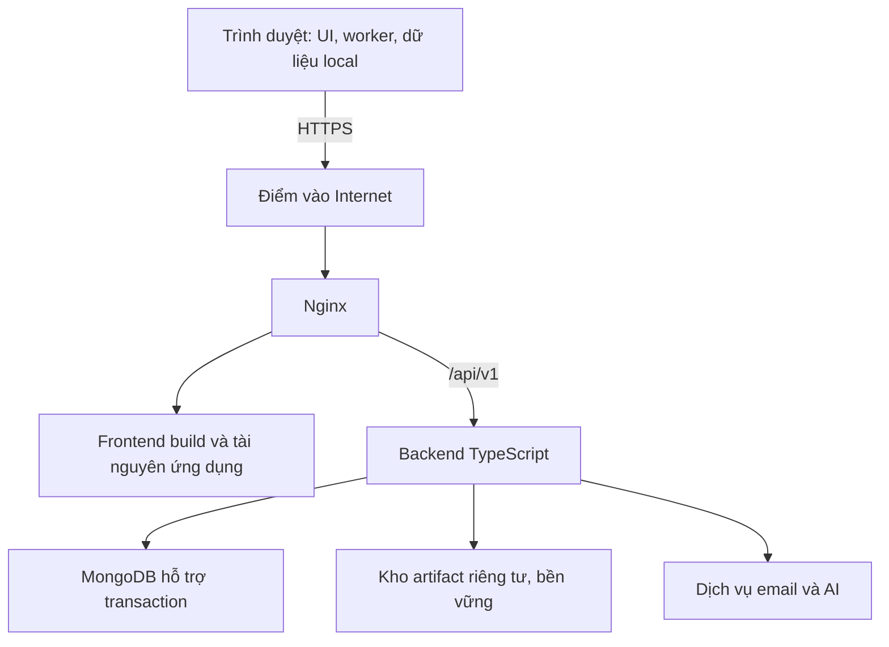

# Prompt giao nhiệm vụ cho Agent — Thiết kế webserver Nginx

**Đề tài:** Xây dựng hệ thống dashboard tương tác 3D quản lý và trực quan hóa toàn bộ quy trình khai phá dữ liệu.

**Ngày cập nhật:** 02/11/2026. **Ngôn ngữ:** Tiếng Việt.

**Trạng thái:** Đặc tả thiết kế và prompt giao agent triển khai sau này; chưa phải cấu hình đã chạy, website đã triển khai hoặc báo cáo kiểm thử.

## 1. Vai trò, nhiệm vụ và tài liệu căn cứ

Bạn là kỹ sư triển khai phụ trách webserver Nginx và tích hợp frontend–backend. Thiết kế điểm truy cập HTTPS công khai, định tuyến, phục vụ tài nguyên, giới hạn truyền tải, cache, bảo vệ hạ tầng, cập nhật và phục hồi. Giải thích thuật ngữ ngắn gọn khi xuất hiện lần đầu.

Đã đọc và đối chiếu trong nhiệm vụ thiết kế này:

1. `thiet_ke_backend.md`: API, phiên, quyền, chunk upload, artifact, lưu trữ, vận hành và backup.
2. `thiet_ke_frontend.md`: website cùng origin, worker, tài nguyên offline, trạng thái và cập nhật ứng dụng.
3. `thiet_ke_offline.md`: Service Worker, cache, dữ liệu cục bộ, outbox và đồng bộ.

Khi triển khai, đọc thêm các bản thực tế được cung cấp của `thiet_ke_chuc_nang_he_thong_.md`, `thiet_ke_caynut_dieukien.md`, `thiet_ke_mongodb.md` và `thiet_ke_3d.md`. Không tuyên bố nhiệm vụ này đã đọc bốn file đó. Nếu khác tên, đối chiếu nội dung và danh tính file; không chọn nguồn chỉ theo hậu tố tên.

Nhiệm vụ hiện tại là đặc tả. Không tự thuê tài nguyên, yêu cầu thanh toán, tạo tài khoản dịch vụ, gửi email thật hoặc sửa repository khi chưa được giao triển khai. Không tự sửa những tài liệu nguồn.

## 2. Những quyết định đã chốt

| Nội dung          | Yêu cầu                                                                                     |
| ----------------- | ------------------------------------------------------------------------------------------- |
| Truy cập          | Website công khai qua Internet; giảng viên/thành viên có thể mở link từ xa                  |
| Quyền dữ liệu     | Điểm vào công khai không đồng nghĩa dự án công khai; dữ liệu riêng từng tài khoản           |
| Hosting           | Chưa có máy chủ, chưa chọn nhà cung cấp; thiết kế trước, kiểm chứng nơi chạy sau            |
| Ngân sách         | Ưu tiên hoàn toàn miễn phí; nếu thiếu tài nguyên thì ghi rõ giới hạn thực tế                |
| Tên miền          | Chưa có; ưu tiên địa chỉ miễn phí phù hợp                                                   |
| Nginx             | Giữ Nginx thực sự trong kiến trúc; không coi proxy tích hợp của hosting là đã đáp ứng Nginx |
| Người dùng cuối   | Chỉ cần trình duyệt; không cài Node.js, MongoDB, Docker hoặc Nginx                          |
| Ngôn ngữ ứng dụng | JS/TS cho frontend, backend và xử lý; không dùng Python trong ứng dụng                      |
| Backend bản đầu   | Một instance modular monolith; REST dưới `/api/v1`                                          |
| Tính toán         | Parse, làm sạch, tiền xử lý, nối/ghép và năm thuật toán chạy trong browser/worker           |
| Quy mô            | Tối đa 100 tài khoản kích hoạt; 100 người đồng thời là mục tiêu kiểm thử                    |
| Dữ liệu           | CSV/JSON; tệp nguồn tối đa 20.000.000 byte; không áp trần đó cho mọi đầu ra                 |
| Lưu trữ           | Metadata MongoDB; artifact riêng tư, bền vững; provider chưa chọn                           |
| Sao lưu           | Thủ công trước demo/thay đổi lớn, gồm cả metadata và artifact                               |

Chấp nhận giới hạn miễn phí không cho phép làm mất dữ liệu đã lưu, công khai file riêng tư, bỏ HTTPS, bỏ Nginx hoặc tự đổi nghiệp vụ offline. Nếu chưa tìm được môi trường miễn phí đạt yêu cầu cốt lõi, ghi trạng thái “chưa đáp ứng triển khai”, nêu bằng chứng và phương án cần thảo luận; không tuyên bố đã hoàn thành hosting.

## 3. Kiến trúc đề xuất



Điểm vào Internet có thể chính là Nginx hoặc proxy HTTPS của nền tảng đứng trước Nginx. Nếu có proxy ngoài, phải mô tả đầy đủ chuỗi tin cậy và nơi kết thúc TLS; TLS là lớp mã hóa kết nối HTTPS. Không thêm proxy ngoài chỉ để làm sơ đồ phức tạp hơn.

Đề xuất đóng gói frontend build cùng Nginx; backend là dịch vụ nội bộ riêng. Docker/container là lựa chọn triển khai của nhóm, không phải phần mềm người dùng cuối phải cài. Nếu chạy cùng một môi trường, chứng minh nền tảng cho phép đủ tiến trình và restart đúng; không giả định mọi gói miễn phí hỗ trợ Docker Compose.

Địa chỉ chuẩn dự kiến có dạng `https://<dia-chi-duoc-cap>/`; placeholder không phải tên miền đã tồn tại. Giao diện và API dùng cùng origin, tức cùng giao thức, hostname và cổng. `PUBLIC_ORIGIN`, cookie, CSRF và frontend API base phải thống nhất.

## 4. Ranh giới trách nhiệm

| Thành phần   | Trách nhiệm                                                                                               |
| ------------ | --------------------------------------------------------------------------------------------------------- |
| Nginx        | Static frontend, routing API, giới hạn HTTP, header, TLS nếu tự kết thúc TLS, log vận hành                |
| Backend      | Phiên, OTP, CSRF, quyền sở hữu, validation, upload protocol, sync/receipt, AI, xóa và kiểm tra tài nguyên |
| MongoDB      | Metadata, phiên, revision, transaction và trạng thái bền vững                                             |
| Kho artifact | Byte dữ liệu/mô hình/báo cáo riêng tư, giữ qua restart và redeploy                                        |
| Browser      | Xử lý dữ liệu, worker, local commit, outbox, offline, UI và bộ nhớ                                        |
| Nền tảng     | Cấp URL, tài nguyên chạy, mạng, persistent storage/TLS theo khả năng đã kiểm chứng                        |

Nginx không chạy thuật toán, không quyết định dataset hợp lệ, không thay cơ chế đồng bộ hoặc kiểm tra chủ sở hữu. Không mở cổng MongoDB hoặc kho artifact cho browser truy cập trực tiếp.

## 5. Điều kiện lựa chọn hosting miễn phí

Chưa chốt tên nhà cung cấp. Agent triển khai phải tra tài liệu chính thức tại thời điểm lựa chọn và lập bảng ứng viên, ghi ngày kiểm tra và nguồn. Không hứa gói miễn phí tồn tại vĩnh viễn hoặc có đủ sức chạy 100 người.

| Tiêu chí cần kiểm chứng | Điều kiện/ảnh hưởng                                                                          |
| ----------------------- | -------------------------------------------------------------------------------------------- |
| Nginx thực tế           | Cho chạy binary/container Nginx và nạp cấu hình của nhóm                                     |
| Backend Node.js         | Cho chạy dịch vụ lâu dài, phù hợp phiên bản Node đã khóa                                     |
| Kết nối nội bộ          | Nginx gọi được API; API không có đường công khai bỏ qua lớp bảo vệ ngoài ý muốn              |
| URL/HTTPS               | Được cấp hostname miễn phí, chứng chỉ hợp lệ và quy trình gia hạn rõ                         |
| Địa chỉ ổn định         | Không đổi hostname sau mỗi redeploy; đổi origin ảnh hưởng kho local và Service Worker        |
| Tài nguyên              | RAM/CPU, số tiến trình, giờ chạy, timeout, request/body và băng thông có số liệu             |
| Sleep/cold start        | Có ngủ khi ít truy cập không; thời gian khởi động đo riêng, UI báo máy chủ chưa sẵn sàng     |
| Disk                    | Phân biệt disk tạm với volume bền vững; redeploy không được xóa artifact đã commit           |
| MongoDB                 | Có phương án hỗ trợ multi-document transaction; không thay bằng standalone bỏ transaction    |
| Artifact                | Kho riêng tư miễn phí với dung lượng/băng thông đủ demo; backend có thể stream có quyền      |
| Email OTP               | Có dịch vụ gửi thật phù hợp sender/domain; URL website miễn phí không tự cấp quyền gửi email |
| AI                      | Tùy chọn khả dụng theo adapter/key/quota; không hứa AI chung miễn phí                        |
| Giới hạn chi phí        | Kiểm tra yêu cầu thẻ, tự chuyển trả phí, trial/credit hết hạn và ngưỡng dừng                 |
| Vận hành                | Xem log, cấu hình secret, restart, health check và lấy backup được                           |

Ưu tiên phương án ít dịch vụ và có thể tái tạo. Chỉ chọn provider sau khi chứng minh các tiêu chí bắt buộc. Nếu gói miễn phí chỉ phù hợp demo, công bố cửa sổ hoạt động và tải đo được; không chuyển thành cam kết 24/7. Không tự bật tài nguyên trả phí hoặc coi credit dùng thử là miễn phí lâu dài.

## 6. Hợp đồng đường dẫn

Các đường dẫn ngoài `/api/v1` dưới đây là đề xuất cần khớp frontend build và backend khi triển khai.

| Đường dẫn                   | Xử lý                                                                      |
| --------------------------- | -------------------------------------------------------------------------- |
| `/` và route UI hợp lệ      | Phục vụ ứng dụng; tải lại deep link hoạt động                              |
| `/api/v1` và `/api/v1/...`  | Chuyển nguyên prefix đến backend; không fallback HTML                      |
| `/api` và API không tồn tại | Lỗi API thích hợp, không trả `index.html`                                  |
| `/assets/...`               | Tài nguyên build, trả 404 nếu thiếu; chỉ cache lâu khi tên có hash         |
| `/sw.js`                    | Service Worker gốc, JavaScript đúng MIME, kiểm tra cập nhật, thiếu trả 404 |
| `/manifest.webmanifest`     | Manifest ứng dụng, đúng MIME; không cache bất biến                         |
| Worker/module/font/texture  | Đúng URL thực của build, đúng MIME và policy hash tương ứng                |
| `/healthz`                  | Chỉ kiểm tra Nginx, không tiết lộ cấu hình/secret                          |
| API readiness/liveness      | Backend công bố theo hợp đồng, không chứa dữ liệu riêng                    |

SPA là ứng dụng điều hướng trong trình duyệt: Nginx chỉ dùng fallback `index.html` ở nhánh điều hướng UI. Tệp JS/CSS/worker thiếu, đường dẫn API và tệp không tồn tại không được nhận HTML 200. Phải kiểm tra ưu tiên `location`, nhất là regex static có thể vô tình bắt URL API.

Nginx `proxy_pass` có thể thay đổi đường dẫn theo cách cấu hình URI; agent phải chứng minh prefix `/api/v1` vẫn đúng bằng test thực tế [S1]. Không tự sửa endpoint backend để khắc phục cấu hình proxy sai.

## 7. HTTPS, origin và chuỗi proxy

1. Mọi đường truy cập production dùng HTTPS với chứng chỉ trình duyệt tin cậy. Service Worker cần secure context; ngoại lệ localhost dành cho phát triển, không thay HTTPS Internet [S4].
2. Chọn một trong hai profile rõ ràng: Nginx tự kết thúc TLS, hoặc nền tảng kết thúc TLS rồi chuyển vào Nginx qua mạng được bảo vệ. Không áp cấu hình redirect y hệt cho cả hai.
3. Nếu Nginx quản lý chứng chỉ, đặc tả cấp/gia hạn, lưu khóa riêng, quyền đọc và thử gia hạn; nếu nền tảng quản lý, ghi trách nhiệm nền tảng và kiểm tra hostname.
4. HTTP công khai chuyển HTTPS; ngăn vòng lặp redirect khi phía ngoài đã dùng HTTPS nhưng kết nối nội bộ là HTTP.
5. Chỉ nhận Host dự kiến. Không để header Host/Forwarded giả làm nguồn dựng URL reset hoặc origin tin cậy.
6. Chuẩn hóa `X-Forwarded-For`, `X-Forwarded-Proto` theo chuỗi proxy thực; Nginx/backend chỉ tin proxy xác định. Không bật `TRUST_PROXY=true` cho mọi nguồn rồi coi IP client là đáng tin.
7. Cookie phiên giữ `HttpOnly`, `Secure` production, `SameSite` và Path theo backend; không sửa Domain/Path tùy tiện hoặc bỏ header `Set-Cookie`.
8. CSRF/Origin do backend kiểm tra; Nginx không mở `Access-Control-Allow-Origin: *` cho API cookie. Không cần tạo CORS rộng chỉ vì có proxy nội bộ.

Địa chỉ miễn phí cần ổn định. Đổi origin không tự chuyển IndexedDB/Cache Storage/outbox sang địa chỉ mới. Nếu phải đổi, lập kế hoạch giữ điểm truy cập cũ và hướng dẫn đồng bộ trước; redirect đơn thuần không di chuyển dữ liệu local. Không yêu cầu xóa site data để sửa lỗi nâng cấp.

## 8. Cache và cập nhật offline

| Loại tài nguyên                             | Chính sách đề xuất                                       |
| ------------------------------------------- | -------------------------------------------------------- |
| `index.html`/navigation online              | `Cache-Control: no-cache` để kiểm tra phiên bản mới      |
| Service Worker script                       | `no-cache`, URL ổn định, đúng scope/MIME                 |
| Manifest/build version không hash           | `no-cache`, không gắn immutable                          |
| Static có content hash                      | Cache lâu, có thể `public, max-age=31536000, immutable`  |
| Static không có hash                        | Revalidate hoặc TTL ngắn, không mặc định cache một năm   |
| API riêng tư, auth, OTP, AI, sync, artifact | `Cache-Control: no-store`; tắt proxy cache               |
| Lỗi static/API                              | Không gắn TTL dài hoặc immutable làm lỗi tồn tại sau sửa |

Các giá trị là lựa chọn thiết kế, cần xác nhận khi có build thật. `no-cache` cho phép lưu nhưng yêu cầu revalidate; không đồng nghĩa `no-store`. Cache HTTP, proxy cache và Cache Storage do Service Worker quản lý là các cơ chế khác nhau. Header HTTP không thay luật cache của Service Worker.

Backend là nơi phát header API chuẩn; Nginx không ghi đè làm yếu đi. Nếu cần áp thêm ở Nginx, tránh hai giá trị Cache-Control mâu thuẫn và phải bao phủ cả lỗi do Nginx tạo. Kiểm tra quy tắc kế thừa `add_header` trên phiên bản Nginx đã chọn, không giả định header cấp server tự còn ở mọi location [S3].

Service Worker chỉ cache shell/static công khai theo manifest; dữ liệu tài khoản được quản lý qua kho local/offline riêng. Không lấy `no-store` API làm lý do cấm lưu có chủ đích vào kho local đã được đặc tả. Không cache chung phản hồi auth/AI/artifact để làm offline.

Frontend tự đóng gói font tiếng Việt, module tính toán, worker và tài nguyên 3D cần thiết; không để CDN ngoài trở thành điều kiện hoạt động offline. Lazy-load phải có danh mục chuẩn bị offline và kiểm tra đủ tài nguyên.

### 8.1. Trình tự phát hành ứng dụng

- Mỗi release có build ID, static hash và schema/API compatibility rõ.
- Upload static mới trước; kiểm tra đủ file/hash, sau đó mới công bố shell/manifest/Service Worker tương ứng.
- Giữ static release cũ trong thời gian chuyển tiếp có cấu hình; không xóa ngay chunk mà tab cũ hoặc thiết bị trở lại online còn cần.
- Chốt khoảng hỗ trợ client cũ dựa tài nguyên đo được; nếu hết hỗ trợ, báo nâng cấp có kiểm soát, giữ local/outbox. Không cam kết giữ static vô hạn trên gói miễn phí.
- Service Worker không ép reload giữa xử lý, migration hoặc đồng bộ; việc kích hoạt phiên bản mới phối hợp với frontend/offline.
- Migration phải giữ dữ liệu chưa sync; không dùng `Clear-Site-Data`, unregister tất cả worker hoặc xóa toàn cache/database như bước deploy mặc định.
- Rollback phải xét cả backend, static và Service Worker đã cài. Đổi thư mục frontend trên server không tự rollback worker trong browser.

## 9. Upload, download và giới hạn truyền tải

### 9.1. Đường truyền dữ liệu

Tệp nguồn tối đa 20.000.000 byte là luật backend theo tổng file gốc, không phải giới hạn mọi HTTP request. Artifact kết quả có thể lớn hơn nguồn; số phiên bản không có trần nghiệp vụ cố định nhưng vẫn chịu kiểm tra tài nguyên.

- Metadata dùng JSON có giới hạn riêng; không đóng toàn file vào JSON/base64.
- Upload chia khối theo protocol backend: uploadId, index/offset, tổng size/hash, retry và complete.
- Đề xuất khởi đầu để đo: chunk byte thuần tối đa 4 MiB (4.194.304 byte), body metadata tối đa 1 MiB. Đây là ngưỡng kỹ thuật đề xuất, chưa là cấu hình đã nghiệm thu.
- Backend công bố chunk size thực tế; Nginx và mọi proxy ngoài phải cho phép cùng ngưỡng, tính overhead nếu có. Nếu môi trường giới hạn nhỏ hơn, thay đổi protocol/config đồng bộ và kiểm thử lại, không chỉ tăng một lớp.
- Backend vẫn kiểm tra tổng file, purpose, số chunk, hash, quyền, phiên, storage và tài nguyên; chia nhỏ không được dùng để vượt tổng size.
- Nginx không áp trần toàn hệ thống 20 MB hoặc `client_max_body_size 0` để né thiết kế. Phân biệt byte thập phân của tệp nguồn với MiB trong cấu hình [S2].

### 9.2. Streaming và buffering

Đối với chunk upload, xem xét `proxy_request_buffering off` khi backend nhận stream và kiểm soát backpressure; backpressure là giới hạn tốc độ nhận theo khả năng ghi xuống. Nếu dùng cấu hình này, xác định HTTP version, hành vi truyền chunked và giới hạn phía nền tảng [S1]. Không suy luận tắt buffering ở Nginx là đã tắt ở proxy ngoài.

Download artifact đi qua backend kiểm tra quyền, stream về browser; cân nhắc `proxy_buffering off` cho route này để tránh file riêng tư bị spool không cần thiết. Không mở `alias` công khai đến thư mục storage. Signed URL hoặc X-Accel-Redirect chỉ là mở rộng sau này, phải có thiết kế quyền riêng.

Nginx vẫn có thể dùng buffer/file tạm ở những nhánh khác. Mô tả vị trí, quota, quyền, cleanup và giám sát disk tạm; không coi disk tạm là kho artifact bền vững. Chọn nén cho JS/CSS/JSON công khai phù hợp, tránh nén lại file vốn đã nén và đo chi phí CPU.

Download thiếu Range/resume không được trả 206 giả. Chỉ công bố resume khi backend có hợp đồng Range/Content-Range và kiểm thử quyền, hash, offset thực tế.

## 10. Timeout, retry và điều tiết tải

Đề xuất điểm bắt đầu để kiểm thử, không phải SLA:

| Nhóm                | Hướng cấu hình                                                                                        |
| ------------------- | ----------------------------------------------------------------------------------------------------- |
| Kết nối Nginx → API | Timeout kết nối khoảng 5 giây, điều chỉnh theo mạng thật                                              |
| API metadata        | Backend deadline hữu hạn; đề xuất 25 giây và proxy read timeout 30 giây                               |
| Upload/download     | Timeout bất hoạt khoảng 60 giây; tổng deadline/kích thước được backend/client quản lý riêng           |
| AI                  | Backend deadline hữu hạn theo adapter; proxy chờ dài hơn deadline có khoảng đệm nếu nền tảng cho phép |
| Cold start          | Báo riêng thời gian thức dậy; không kéo mọi timeout vô hạn để che lỗi                                 |

`proxy_read_timeout`/`proxy_send_timeout` không phải giới hạn tổng thời gian một tác vụ; chúng liên quan khoảng chờ giữa các thao tác I/O [S1]. Kiểm tra timeout nhỏ nhất của cả browser–platform–Nginx–backend–provider trước khi chốt số.

- Không cần giữ request Nginx suốt quá trình huấn luyện browser. Bản đầu không yêu cầu WebSocket/SSE chỉ để hiển thị tiến độ local.
- Không tự retry mutation/upload complete/sync commit hoặc request AI ở proxy. Dù HTTP method cho phép retry ở vài ngữ cảnh, nghiệp vụ vẫn cần receipt/idempotency phía backend. Đề xuất tắt upstream retry tự động cho API bản đầu một instance.
- AI timeout có thể có trạng thái chưa rõ provider đã xử lý; không đổi key/provider hoặc gọi lại tự động.
- Chống tải bất thường tại Nginx ở mức IP/connection; backend giới hạn thêm theo account/challenge/purpose. Không thay giới hạn OTP đã chốt bằng ngưỡng Nginx.
- Chưa chốt ngưỡng IP cố định vì nhiều người có thể chung Wi-Fi trường/NAT. Đo theo kịch bản rồi cấu hình; ưu tiên 429 với Retry-After khi biết được thời gian chờ.
- Khi hết disk/RAM/quota hoặc dịch vụ chưa sẵn sàng, từ chối rõ ràng; không trả thành công hoặc cắt dữ liệu âm thầm. Client giữ local/outbox.

## 11. Header, tệp và bề mặt công khai

- Phục vụ đúng MIME cho JavaScript module, CSS, JSON, font và worker; dùng `X-Content-Type-Options: nosniff`.
- Đề xuất `Referrer-Policy: strict-origin-when-cross-origin`; đặt chính sách chống nhúng bằng CSP `frame-ancestors`/header tương thích theo quyết định UI.
- Xây CSP theo build thật, worker, engine 3D và các kết nối cần thiết. Thử ở Report-Only trước nếu cần; không bật `unsafe-eval` hoặc wildcard rộng chỉ để hết lỗi. CSP không thay validation/sanitize dữ liệu.
- Chỉ bật HSTS sau khi HTTPS/gia hạn đã ổn định; không bật preload/includeSubDomains vô điều kiện cho hostname dùng chung hoặc chưa kiểm soát.
- Không tự bật COOP/COEP nếu ứng dụng chưa cần SharedArrayBuffer; nếu cần thì kiểm tra hệ quả với worker/tài nguyên/cửa sổ ngoài.
- Chặn directory listing, `.env`, khóa, `.git`, file backup, source server và storage riêng. Nếu dùng ACME, cho phép đúng challenge cần thiết trước quy tắc chặn dotfile.
- Source map production không công khai mặc định; cân nhắc nhu cầu debug và dữ liệu chứa trong map. Secret không được đi vào build dù map có bị tắt.
- Nginx/API chạy quyền tối thiểu; secret được cấp qua cơ chế runtime, không bake trong image, repository hoặc frontend.
- Nếu API buộc có URL công khai riêng do nền tảng, phải có cơ chế ngăn truy cập bỏ qua Nginx và xác minh rõ; chỉ CORS không chặn được client ngoài browser.

## 12. Lỗi, request ID và log

API không trả HTML SPA cho lỗi. Giữ status/body có cấu trúc từ backend, bao gồm 401/403/404/409/410/413/422/429/503 và mã ứng dụng theo hợp đồng. Không đổi mọi lỗi thành 200 hoặc thông báo mất mạng.

Lỗi Nginx tạo cho API như 413/502/503/504 cần JSON an toàn theo envelope thống nhất, Cache-Control no-store và requestId; không lộ địa chỉ upstream/đường dẫn máy chủ. Giữ lỗi UI riêng, không dùng một `error_page` chung biến lỗi API thành trang frontend.

Tạo hoặc chuẩn hóa requestId có giới hạn và chuyển tới backend; tránh trùng hai header mang giá trị khác nhau. Nếu platform cấp ID, ghi rõ mapping. Không coi requestId từ client là bằng chứng quyền.

Access log tối thiểu: thời điểm, requestId, method, route/path đã lọc, status, thời gian, upstream status/time và số byte. Không log query string tùy ý, cookie, Authorization, password, OTP, API key, revocation handle, request/response body hoặc row/prompt AI. Error log cũng cần được kiểm tra vì có thể chứa request URI. Không đưa bí mật vào URL ngay từ thiết kế API.

Cấu hình rotate/retention theo quota, tránh log làm đầy disk. IP nếu cần cho vận hành có thời hạn lưu và quyền đọc rõ. Theo dõi lỗi proxy, latency, connection, cold start, disk tạm/storage, DB pool và tỷ lệ sync thất bại. Log không thay receipt hay trạng thái nghiệp vụ bền vững.

## 13. Khởi động, health check và bảo trì

Phân biệt `/healthz` của Nginx, liveness của tiến trình API và readiness cho tác vụ cần DB/storage. Static còn phục vụ được không chứng minh API sẵn sàng. Không trả URI DB, secret, stacktrace hoặc dữ liệu người dùng ở health endpoint công khai.

Kiểm tra config/env khi khởi động; Nginx chỉ chuyển API sau khi upstream sẵn sàng theo phương án triển khai. API graceful shutdown, ngừng nhận việc mới và xử lý hữu hạn request đang chạy. Restart không làm artifact đã commit biến mất.

Khi bảo trì, giữ giao diện/static nếu khả thi; API thông báo trạng thái rõ. Chặn commit mới và điều phối tác vụ đang chạy ở backend, không chỉ chặn vài URL Nginx rồi coi DB đã nhất quán. Frontend giữ local/outbox, không báo đồng bộ xong khi nhận trang bảo trì.

Sleep/cold start của free tier được xem là trạng thái máy chủ không truy cập được/chưa sẵn sàng; không giả phiên bị thu hồi. Người dùng vẫn làm việc offline nếu đủ tài nguyên theo đặc tả. Khi server trở lại sau gián đoạn, frontend chờ nút “Đồng bộ ngay”, Nginx không tự điều khiển sync.

## 14. Cấu trúc triển khai và cấu hình

Đề xuất khi được giao triển khai repository:

```text
infra/
  nginx/
    nginx.conf
    conf.d/app.conf
    snippets/                 # Proxy/header/lỗi dùng chung nếu cần
    Dockerfile                # Khi nền tảng hỗ trợ container
  compose.yaml                # Chỉ khi môi trường dev/demo phù hợp
docs/operations/
  deployment.md
  hosting-evaluation.md
  backup-restore.md
  demo-runbook.md
```

Đường dẫn là đề xuất, phải theo cấu trúc repo thực tế và quy tắc phạm vi sửa. Không tạo Compose như bằng chứng nền tảng cloud hỗ trợ nó. Dev trên máy thành viên được dùng localhost; nghiệm thu Internet dùng URL HTTPS thật.

Nhóm cấu hình tối thiểu: hostname/public origin; nơi kết thúc TLS; upstream và prefix API; proxy tin cậy; static root/build ID; body/chunk limits; timeouts; log retention; đường dẫn health; private storage; hỗ trợ release cũ và chế độ bảo trì. Không đưa mật khẩu/secret mẫu giống thật vào tài liệu.

Khóa phiên bản Nginx/Node/dependency sau khi xác minh tài liệu và tương thích; không dùng nhãn `latest` không kiểm soát. Khi render template Nginx bằng envsubst hoặc công cụ tương tự, chỉ thay biến allowlist để không làm mất biến Nginx như `$uri`, `$host`, `$request_id`. Thiếu cấu hình bắt buộc phải dừng khởi động.

## 15. Quy trình triển khai, rollback và backup

1. Đọc hợp đồng hiện hành và đánh giá hosting; ghi provider, điều khoản miễn phí, giới hạn và điểm chưa đáp ứng.
2. Build frontend/backend với dependency đã khóa; kiểm tra không có secret trong bundle, image hoặc artifact công khai.
3. Chạy kiểm tra cấu hình `nginx -t` trong môi trường đúng phiên bản, kiểm tra readiness và smoke test nội bộ.
4. Backup thủ công nhất quán MongoDB và artifact trước thay đổi lớn; kiểm tra hash/manifest và thử restore theo backend. Chỉ backup database chưa đủ.
5. Đưa static mới lên trước, công bố release có kiểm soát; migration tương thích với client cũ và không làm mất local/outbox.
6. Reload Nginx hoặc deploy theo nền tảng, bảo toàn request hữu hạn đang chạy; đo downtime thực tế, không hứa zero downtime trên free tier.
7. Smoke test HTTPS, deep link, đăng nhập, API, chunk upload/download, Service Worker và client cũ; chỉ báo thành công sau có bằng chứng.
8. Nếu lỗi, quay lại release tương thích. Không restore DB cũ chỉ để rollback UI. Migration dữ liệu không đảo ngược cần phương án riêng.
9. Restore server snapshot cũ phải theo backend: server generation mới, thu hồi phiên và đối chiếu deletion ledger để tránh tái sinh dữ liệu đã xóa. Không mở ghi lại khi chưa giải quyết nhất quán.

Backup không chứa dữ liệu local chưa đồng bộ. Không thêm lịch backup tự động ngoài yêu cầu đã chốt. Không sửa Nginx để bỏ kiểm tra quyền/phiên nhằm làm demo chạy.

## 16. Ma trận nghiệm thu tối thiểu

Đây là kế hoạch kiểm thử khi triển khai; chưa tuyên bố đã chạy các ca sau.

| Mã   | Tình huống                          | Bằng chứng cần có                                                                  |
| ---- | ----------------------------------- | ---------------------------------------------------------------------------------- |
| WS01 | Mở từ mạng Internet khác            | URL HTTPS hợp lệ, có Nginx thật trong đường đi                                     |
| WS02 | HTTP/HTTPS qua chuỗi proxy          | Redirect đúng, không vòng lặp, cookie Secure dùng được                             |
| WS03 | Reload deep link UI                 | App mở đúng route, không 404 do routing                                            |
| WS04 | API sai path/backend lỗi            | Status/JSON đúng; không HTML 200 hoặc SPA fallback                                 |
| WS05 | Thiếu JS/worker/font                | 404 đúng MIME/policy, không index.html giả                                         |
| WS06 | Cache static/API                    | Hash cache lâu; auth/AI/artifact/lỗi riêng tư no-store, không proxy cache          |
| WS07 | Giả Host/Forwarded/IP               | Không giả origin/quyền/IP tin cậy, không bypass kiểm soát                          |
| WS08 | Truy cập `.env`, backup, DB/storage | Không có dữ liệu riêng hoặc secret qua URL/cổng công khai                          |
| WS09 | Chunk tại biên và quá giới hạn      | Nginx/backend/platform thống nhất; 413 rõ, không ready giả                         |
| WS10 | Tệp nguồn vượt 20.000.000 byte      | Backend chặn tổng size dù chia nhỏ                                                 |
| WS11 | Artifact hợp lệ lớn hơn 20 MB       | Đi qua nhiều chunk theo ngưỡng tài nguyên, không bị trần nguồn chặn nhầm           |
| WS12 | Retry/mất ACK/mất mạng khi upload   | Không trùng version/byte; giữ local/outbox và xác minh receipt                     |
| WS13 | Download tài khoản khác/hết phiên   | Bị backend chặn; không URL storage công khai hoặc cache rò dữ liệu                 |
| WS14 | API/AI timeout                      | Status rõ; proxy không gọi lại mutation/AI gây tác dụng lặp                        |
| WS15 | Nhiều người chung IP                | Rate limit không khóa nhầm toàn lớp theo cấu hình chưa đo                          |
| WS16 | Chuẩn bị offline rồi mất Internet   | UI/3D/font/worker đã chuẩn bị hoạt động; không cần server local                    |
| WS17 | Client cũ đang chạy khi deploy      | Chunk cũ còn theo cửa sổ hỗ trợ, không ép reload/mất local                         |
| WS18 | Cập nhật Service Worker/migration   | Tương thích, không xóa outbox hoặc cache dữ liệu tài khoản ngầm                    |
| WS19 | Restart/redeploy backend/Nginx      | Metadata/artifact đã commit vẫn đủ và đúng hash                                    |
| WS20 | Sleep/cold start/server hỏng        | UI phân biệt trạng thái, không xóa local hoặc tự nhận sync thành công              |
| WS21 | Hết disk/quota/log tăng             | Lỗi rõ, không mất commit cũ; log không làm đầy disk vô hạn                         |
| WS22 | Log request chứa dữ liệu nhạy cảm   | Không password/OTP/key/cookie/body/query nhạy cảm trong mọi lớp log kiểm soát được |
| WS23 | Config sai/reload/rollback          | Config bị chặn trước phát hành; phục hồi release tương thích                       |
| WS24 | Backup/restore                      | Đủ DB và byte artifact, generation/phiên/xóa được xử lý đúng                       |
| WS25 | Tải tăng 10 → 25 → 50 → 100         | Báo p50/p95, lỗi, RAM, kết nối, băng thông và tải thực tế đạt được                 |

Tách tải đọc metadata, sync nhỏ, chunk upload, download và AI giả. Không đồng nhất 100 người đồng thời với 100 upload/AI. Không gửi email hoặc AI trả phí thật để benchmark. Ghi rõ cold start và tải giới hạn bởi provider. Nếu chưa đạt mục tiêu, báo con số đo được và điểm nghẽn; không thay yêu cầu hoặc bịa kết quả.

## 17. Sản phẩm agent triển khai phải bàn giao

1. Bảng đối chiếu yêu cầu, giải pháp, giả định và giới hạn miễn phí; nguồn kiểm chứng hosting có ngày kiểm tra.
2. Sơ đồ mạng thực tế, nơi kết thúc TLS, origin chuẩn, port và trust proxy.
3. Cấu hình Nginx hoàn chỉnh cho môi trường đã chọn; phân biệt dev với production, không để placeholder trong bản chạy.
4. Hợp đồng routing/cache/header/body/timeout với frontend–backend–offline và xử lý lỗi JSON.
5. Cách build, khởi động, kiểm tra, triển khai, reload/rollback, backup/restore và phục vụ demo.
6. Báo cáo nghiệm thu có bằng chứng, phiên bản, tải đo và những tiêu chí còn chưa đạt.
7. Danh sách điều chỉnh liên tài liệu nếu cần; không tự sửa nghiệp vụ hoặc bỏ Nginx vì hosting không hỗ trợ.

## 18. Nguồn kỹ thuật và điểm chưa chốt

Các nguồn chính thức được tham chiếu ngày 02/11/2026; agent triển khai kiểm tra lại phiên bản dùng thật. Nguồn giải thích hành vi công cụ; các ngưỡng chunk/timeout và cấu trúc triển khai ở trên là đề xuất của đặc tả.

- **[S1] Nginx proxy module:** `proxy_pass`, buffering, timeout và upstream retry. https://nginx.org/en/docs/http/ngx_http_proxy_module.html
- **[S2] Nginx core module:** `location`, `try_files`, `client_max_body_size` và file tạm. https://nginx.org/en/docs/http/ngx_http_core_module.html
- **[S3] Nginx headers module:** cache header, `always` và kế thừa header theo phiên bản. https://nginx.org/en/docs/http/ngx_http_headers_module.html
- **[S4] MDN Service Worker API:** secure context, scope và lifecycle của Service Worker. https://developer.mozilla.org/en-US/docs/Web/API/Service_Worker_API
- **[S5] Nginx Beginner’s Guide:** static, reverse proxy, reload và quản lý cấu hình. https://nginx.org/en/docs/beginners_guide.html

Còn chốt khi triển khai: provider/URL miễn phí; nơi kết thúc TLS; MongoDB/kho artifact/mail; tài nguyên và chính sách sleep; framework/build path thực; giới hạn request/chunk/timeouts đo được; thời gian giữ release cũ; ngưỡng rate limit và khả năng đạt tải mục tiêu. Các mục này không cản trở hoàn thành đặc tả nhưng phải được giải quyết trước nghiệm thu website Internet.

**Ưu tiên:** điểm truy cập Internet đúng HTTPS, giữ Nginx thực sự, dữ liệu tài khoản riêng tư, không mất local/outbox khi nâng cấp, lưu trữ bền vững và công bố trung thực giới hạn môi trường miễn phí.
